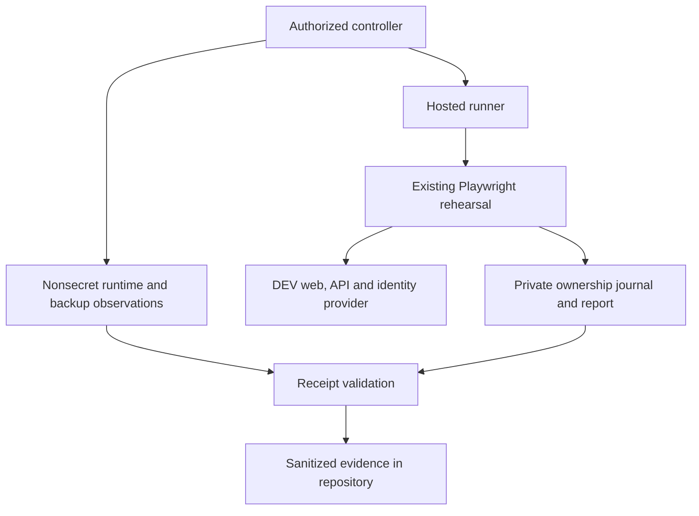
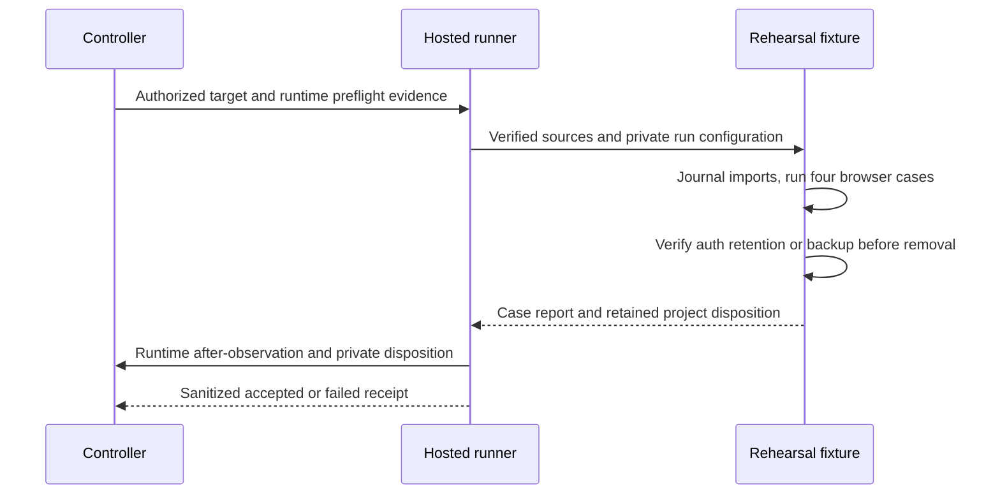
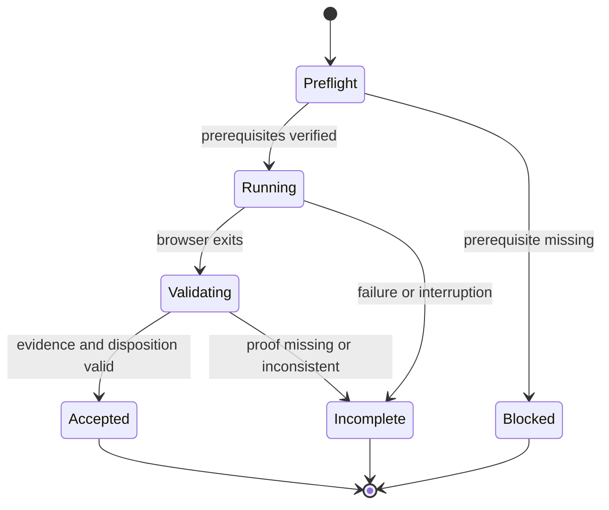
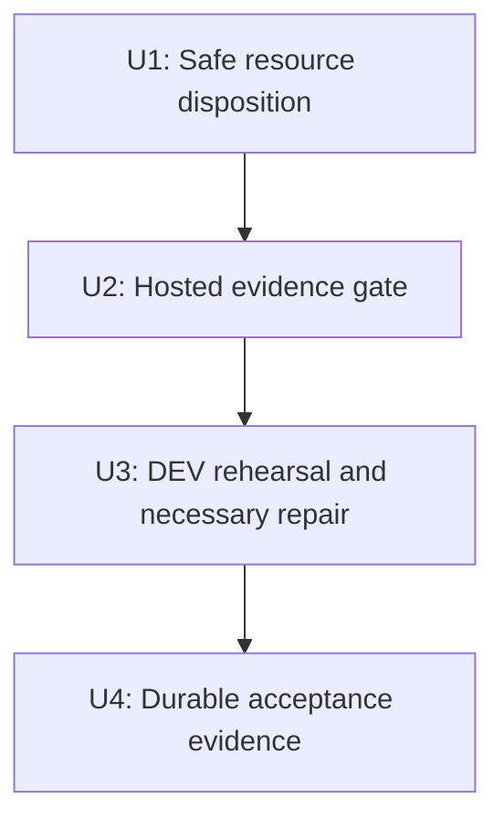

# Finish ow-1 DEV BAIF rehearsal - Plan

## Goal Capsule

- **Objective:** Demonstrators can complete the FOLIO and Catholic OS contribution journeys on DEV before BAIF in Rome on 2026-11-05/06, with a passing scripted rehearsal and durable evidence.
- **Means:** Finish the hosted acceptance remainder of the existing D11 rehearsal (KTD1), with accurate evidence and safe resource disposition (KTD2–KTD4).
- **Authority:** The current ow-1 mandate and campaign restrictions govern this item; `AGENTS.md` and `docs/plans/2026-09-20-0649-requirements-delivery-roadmap.md` govern repository work. The chief repository's `docs/plans/2026-10-26-0705-feat-codex-drawdown-campaign-plan.md` is upstream campaign authority. Its Goal Capsule and Campaign R11, R15–R20 must be reconciled by the controller before execution; that repository is not exposed in this clone. The rules reproduced in the mandate are the available campaign source, not a claimed reading of the missing document.
- **Execution boundary:** One planned item on `drawdown/ow-1`, targeting `dev`. This document plans implementation; its creation does not execute the rehearsal. The later build stage uses the mandated lfg workflow locally. The controller handles credentialed execution, scanning, push and PR creation; the campaign gate handles merge. The worker does not add a remote, seek credentials, deploy, or bypass required checks.
- **Stop conditions:** R6–R8 bind all execution. A missing hosted prerequisite blocks only its dependent action. Local work proceeds without waiting for Damien, and an unavailable DEV run remains unaccepted.

---

## Product Contract

### Summary

Complete hosted proof for the already-integrated BAIF rehearsal, repair only failures that prevent those journeys, and land public-safe evidence under `docs/plans/evidence/`.

### Problem Frame

The clone already contains the rehearsal implementation and its follow-up handoff. Its committed receipt proves a historical isolated run, not current DEV behavior. The previous handoff names unverified DEV personas as the hosted blocker. Current source also deletes run-owned projects and private artifacts without backup verification, which conflicts with the campaign's hard stop.

This plan is the canonical continuation for ow-1's remaining hosted work. The broader `docs/plans/2026-10-20-rehearsal-folio-catholic-ctt-plan.md` remains the historical design for the delivered harness and CTT import; those features are not being rebuilt.

### Requirements

**Rehearsal outcome**

- R1. The existing four-case rehearsal passes against the intended DEV web/API pair with real provider sign-in and three distinct ordinary personas: owner, suggester and editor.
- R2. Preserve FOLIO tree/search/detail browsing and the contributor's label proposal followed by the separate reviewer's approval and merge, including the merged API, source and main-branch UI assertions.
- R3. Preserve Catholic OS browsing, the existing uncalibrated CTT assertions, and the contributor's Catholic label proposal followed by separate reviewer approval and merge.
- R4. Preserve the current upstream pins, both accepted rehearsal edits, CTT namespace and quotation behavior. Fix only defects that prevent R1–R3; API defects are handed to the paired API lane with a reproducible contract failure.

**Proof and constraints**

- R5. Commit a sanitized DEV receipt and readable outcome note under `docs/plans/evidence/`, identifying the tested runtime pair and four mandatory case outcomes. Historical/local/fake runs never count as hosted acceptance.
- R6. Never delete data or files without verified backup. Hosted resource ownership and disposition must be recorded even after partial failure; retention must not be described as deletion or complete cleanup.
- R7. Preserve and strengthen existing tests. Any frontend repair requires a Playwright screenshot of the changed page committed under `docs/plans/evidence/`, with its path reported as `SCREENSHOT: <path>` at build completion.
- R8. Apply the mandate's hard stops and public-safe writing rules: no spend, security-setting or credential changes, messages in Damien's voice, force-push, new service, migration, data rewrite or package release. Workers never read credential files, `.env*`, `*.pem`, `*.key`, `twin-secrets/` or secret stores. Credentialed execution stays with the controller's existing authorized runner.

### Scope Boundaries

D11 advances the rehearsal slice of B08/B09 and gives bounded B02/B03/B11 hosted evidence. It does not complete those wider requirements. Full D08–D10 persona UAT belongs to ow-2; notification hardening, roadmap reconciliation, hydration/polish and general hygiene belong to later items. ALEA AWS provisioning, CTT decisions and upstream ontology publication remain outside this item.

A new backup service, automatic hosted project garbage collection, new auth provisioning, automatic import retries and a replacement rehearsal framework are considered and not built. Existing controller facilities and exact run ownership are sufficient; revisit only if the hosted prerequisites demonstrate otherwise.

### Actors and Acceptance Examples

- A1. Owner imports the run-tagged projects and assigns membership.
- A2. Suggester browses and proposes both ontology edits.
- A3. Editor reviews and merges each proposal in a separate authenticated context.
- A4. Controller supplies the authorized DEV execution environment and returns sanitized evidence.

- AE1. Covers R1–R5: all four cases pass once each on the attested DEV pair; source pins, merged labels and CTT checks match; the receipt identifies this as hosted rehearsal.
- AE2. Covers R5–R6: a FOLIO import succeeds but the Catholic import fails; the receipt records the known project and any uncertain import attempt, preserves unbacked data, and does not claim acceptance.
- AE3. Covers R5–R7: a missing case, skipped/retried case, runtime mismatch, interrupted run or unresolved resource disposition cannot produce a passing DEV receipt.

---

## Planning Contract

### Re-verified Starting State

Source and Git inspection on 2026-10-26 established the following. No application tests, builds, source downloads or runtime probes were run during planning.

| Evidence | Current observation | Consequence |
|---|---|---|
| Git HEAD `43783d39e37f43b222516f737c4cff6837e5c547` | Clean `drawdown/ow-1`; no configured remote | Commit locally; controller publishes |
| Ancestor `f3228d7b` | Rehearsal PR #68 integrated | Do not cherry-pick or recreate it |
| HEAD `43783d39` | Handoff PR #69 integrated, including keep-both rehearsal-edit answer | Keep `scripts/rehearsal/pins.mjs` targets |
| Named rehearsal/sweep `origin/*` refs | Not present in this clone | Use integrated files/history; controller reconciles current `dev` |
| `docs/releases/d11-rehearsal-run-b8f83d0879baa4677f72f4a57a0c6739.json` | Historical 4/4 at web `f642426b`, API `c682a2f2`; `local-verification`, `hostedAcceptance: false` | No fresh or hosted pass claimed |
| `e2e/browser/rehearsal.spec.ts` | All four requested browser journeys already implemented | Preserve exact inventory and assertions |
| `scripts/rehearsal/hosted.mjs` | `webRevision()` reads runner checkout; preflight checks health/provider only | Separate runner identity from hosted identity |
| `e2e/fixtures/rehearsal.ts` | Imports public run-tagged copies, stores returned IDs in memory, unconditionally deletes projects and auth files in teardown | Reconcile R6 before hosted execution |
| `scripts/rehearsal/hosted.mjs` | Removes private run directory before receipt construction | Persist outcome and verify backup before removal |
| `scripts/rehearsal/rehearsal.test.mjs` | Target/preflight/failure privacy tests exist; hosted success/report-rejection matrix is missing | Add tests through current injection seams |

The historical persona/Mailpit and MinIO deployment issues in `docs/handoffs/2026-10-20-sweep-cloud-ontokit-web.md` are execution-time checks, not assumed current failures. The companion API repository and deployed runtime are unavailable here.

### Key Technical Decisions

- KTD1. **Extend the existing rehearsal.** Keep `e2e/browser/rehearsal.spec.ts`, the rehearsal profile, source staging and `validateReport` as the journey and inventory authorities. This is the smallest way to fulfill R1–R4; a second harness would duplicate proven behavior.
- KTD2. **Preserve hosted projects by default.** Journal the full run marker before each import and each returned project ID immediately. Do not issue hosted project DELETE requests in this item; later removal requires the controller's verified backup. A lost import response remains an unresolved attempt until the controller reconciles that exact marker. A source export is not a backup of project metadata, memberships or PR history. Governs implementation of R6.
- KTD3. **Resolve private disposition through safe retention or verified backup.** Default to protected retention when backup verification is unavailable, using an owned, access-restricted location that survives normal run cleanup, such as the ignored `.e2e-runs/retained/` tree. Record and verify retention without exposing private contents or paths in public evidence. Deletion remains optional and requires an existing controller-owned backup facility covering auth files before their removal and the complete run directory before its removal. Its bounded verification result must match that run and the final artifacts; a boolean preference or pre-run snapshot is insufficient. Safe, known retention satisfies disposition; failed or unknown preservation blocks acceptance. Keep ownership/mode/symlink checks and existing credential-removal assertions for verified-removal tests. This introduces a narrow disposition seam, not a backup service. Governs R6 and R8.
- KTD4. **Separate runner, runtime and outcome evidence.** Keep the checkout revision explicitly labeled as runner identity. Obtain controller-issued nonsecret before/after DEV runtime observations from the existing deployment-status path, with run correlation, target origins, UTC observation times, actual web/API/worker identities and provenance. Require the selected runtime pair to match both observations. Retain the local receipt's explicitly non-hosted semantics. Only allowlisted evidence reaches durable output; raw exceptions and Playwright reports remain private. Governs R5.
- KTD5. **Finish locally under campaign ownership.** Use Astra for campaign agent work (session-settled: user-directed — chosen over the Sol-first ladder: the campaign specifies Astra). The controller owns publication and authorized hosted execution under the Goal Capsule's boundary. No code or test changes occur in this plan stage.
- KTD6. **Continue independent work without user waits.** Proceed around environmental prerequisites (session-settled: user-directed — chosen over waiting for Damien: he has zero campaign time through 2026-10-30). The mandate's expansion merge policy and preference for durable hygiene over speculative features remain settled; neither authorizes adding another item here.

### Assumptions and Execution Prerequisites

The following are unverified execution prerequisites, not reasons to suspend local implementation:

| Prerequisite | Owner and evidence needed | Blocks |
|---|---|---|
| Chief campaign text and current base | Controller checks only the Goal Capsule and cited R-IDs, then reconciles current `dev` with this clone | Execution authority reconciliation |
| Three ordinary verified DEV personas | Controller provides the existing authorized target to the external runner, without sending its contents to the worker; confirms distinct accounts and intended privileges | Real hosted sign-in |
| Current DEV pair | API lane/controller returns sanitized actual web/API/worker status and selected pair; reviews historical MinIO issue only if a deployment needs it | Runtime acceptance |
| Private artifact disposition | External runner verifies protected retention under KTD3; controller backup proof is needed only if removal is chosen | Acceptance when disposition is unknown or unsafe; deletion without backup |
| Source cache | Authorized runner prepares/verifies current pinned inputs and the existing CTT snapshot; sources stay ignored | Imports |
| Execution environment | Controller provides Playwright/Chromium and, for isolated checks, the paired API checkout and Docker-capable environment | Real browser/full-stack checks |

Assumption: retaining two run-tagged public rehearsal copies is acceptable while their deletion lacks backup proof. This is the reversible default required by R6, not permission to accumulate untracked copies. Record known retained IDs and reconcile uncertain imports before rerunning.

Assumption: the current hosted login UI and deployed suggestion endpoints remain compatible with the existing fixtures. Any mismatch must be reproduced before changing auth selectors or application behavior.

### High-Level Technical Design

**Ownership and evidence paths:**

**Execution protocol:**

**Run lifecycle:**

**Disposition decisions:**

| Resource and condition | Required behavior |
|---|---|
| Known hosted project | Retain; journal exact ID and run marker |
| Import started, response uncertain | Retain; reconcile by exact marker before another run |
| Private files with verified matching backup | Existing removal allowed; record verification outcome |
| Private files without matching backup | Verify protected retention; report retained disposition |
| Private retention fails or cannot be verified | Preserve remaining data; no accepted receipt |
| Unrelated project or unowned directory | No mutation |

**Unit dependencies:**

### Risks and Limits

Hosted imports are large and asynchronous. Preserve existing bounded waits; do not hide stalls with retries or broadly inflated timeouts. A lost import response or hard kill may outlive the worker, so the journal must survive the runner's normal cleanup and be reconciled before acceptance. Equal before/after runtime observations prove only those observations; any claim of an unchanged execution window also needs the controller's deployment record.

Backup verification, when removal is chosen, must cover the final private files, not just the input target or ontology snapshots. Missing backup coverage chooses protected retention, not failed acceptance. Failure to verify retention does block acceptance. Retained credentials remain subject to the same private access restrictions and controller-managed cleanup after backup verification; do not add a service or credential mechanism for this purpose.

---

## Implementation Units

### U1. Make hosted resource disposition safe and observable

**Goal:** Satisfy R6 before executing the real hosted runner.

**Requirements:** R6, R8; KTD2–KTD3. **Dependencies:** none for local implementation; verified protected retention for hosted completion, or controller backup coverage if removal is chosen.

**Files:** `e2e/fixtures/rehearsal.ts`, `e2e/fixtures/run.ts`, `scripts/rehearsal/hosted.mjs`; proposed `scripts/rehearsal/disposition.mjs` and `scripts/rehearsal/disposition.test.mjs`; `scripts/rehearsal/rehearsal.test.mjs`; `package.json` only if needed to include the new focused test in the existing suite.

**Approach:**

1. Extract only the journal/disposition behavior needed by the current worker and runner; keep the hosted target discriminant and isolated cleanup boundary explicit.
2. Persist import attempts before requests and append returned IDs before membership/index work. Keep the journal outside any directory scheduled for removal, private and correlated to the run.
3. Apply KTD2 to hosted teardown and KTD3 at both private deletion points. Verify the default protected-retention path with the existing private-directory checks. Use a narrow injected verification interface for backed-up removal tests and an existing controller adapter only if removal is chosen; no generic arbitrary-command hook.
4. Preserve existing isolated cleanup behavior and all existing assertions. Test setup may gain synthetic verified-backup fixtures; missing-backup cases are additional tests, never a reason to remove the original credential-removal/privacy assertions.

**Patterns:** exact-ID ownership in `e2e/fixtures/rehearsal.ts`; private directory checks in `scripts/e2e/ownership.mjs`; existing injected runner dependencies.

**Execution note:** Characterize current cleanup assertions first with synthetic inputs; add failure cases before changing hosted teardown.

**Test scenarios:**

1. A hosted successful run retains exactly its two known projects and records their disposition without issuing DELETE requests.
2. Second import failure retains the first project; a timed-out import records an unresolved marker without claiming no resource was created.
3. Missing, stale, mismatched or failed backup verification prevents private deletion; verified protected retention still permits otherwise-valid acceptance.
4. Verified coverage of final auth/run artifacts permits original cleanup assertions to pass; a later-created file invalidates stale coverage.
5. Cancellation preserves recoverable ownership evidence; an unrelated project, symlink or unowned directory is never mutated. Failed or unknown private retention refuses acceptance.
6. Isolated cleanup assertions remain enforced; test disposal itself runs only in a backed-up disposable environment.

**Verification:** All existing cleanup/privacy tests plus new disposition tests pass without assertion weakening; no real DEV data is touched by unit tests.

### U2. Make the hosted receipt sufficient to establish DEV acceptance

**Goal:** Produce accurate, public-safe evidence for R5 and reject incomplete runs.

**Requirements:** R1, R5–R8; KTD1, KTD4. **Dependencies:** U1.

**Files:** `scripts/rehearsal/hosted.mjs`, `scripts/rehearsal/rehearsal.test.mjs`, `scripts/e2e/evidence.test.mjs`; `scripts/e2e/evidence.mjs` only for a small reusable sanitizer; `e2e/fixtures/run.ts` if the bounded run configuration needs additional nonsecret fields.

**Approach:**

1. Bind the controller's runtime observations to the run and intended DEV origins; distinguish these from the local checkout. Reuse existing status evidence instead of inventing an API endpoint.
2. Keep `validateReport` and `sanitizedRehearsal` authoritative. Add disposition and runtime validation to the hosted acceptance predicate.
3. Persist safe terminal outcomes before removing the sole working evidence. Include preflight failure, missing report, interruption, unresolved disposition and receipt-write failure; a failed write is never described as a saved receipt. An unavailable backup with verified retention is a recorded retained outcome under KTD3.
4. Sanitize failure output through fixed categories and allowed values. Do not serialize arbitrary target JSON, exception messages, browser reports, emails, user IDs, tokens or private paths.

**Patterns:** `validateReport` and `sanitizedRehearsal` in `scripts/e2e/evidence.mjs`; injected `fetchImpl`, `stage` and `runPlaywright` in hosted runner tests.

**Test scenarios:**

1. Covers AE1: synthetic exact four-case report, pinned sources, matching runtime observations and resolved disposition produce a hosted accepted receipt for both verified retention and verified backed-up removal.
2. Covers AE3: missing/duplicate/extra case, wrong project/file, skip/fixme/expected failure, retry, flaky result, runner error or nonzero exit each rejects acceptance.
3. Missing/mismatched/stale runtime observations cannot be replaced by the runner checkout SHA; before/after observations for different runs are rejected.
4. Missing/malformed report, source mismatch, setup failure and SIGINT/SIGTERM yield safe failed outcomes while preserving U1 evidence.
5. Inject sentinel secrets, emails, private paths and arbitrary extras into inputs/errors; none reach receipt or public console output.
6. Local receipts remain `local-verification` with `hostedAcceptance: false`; failed receipt persistence yields a failing exit and no claimed artifact.

**Verification:** New successful/adversarial hosted tests pass alongside all existing profile, evidence and rehearsal tests.

### U3. Run the existing DEV journeys and repair only demonstrated blockers

**Goal:** Observe R1–R3 on the real intended deployment.

**Requirements:** R1–R4, R7–R8; KTD1, KTD5–KTD6. **Dependencies:** U1–U2 and the controller prerequisites.

**Files:** `e2e/browser/rehearsal.spec.ts` and `e2e/fixtures/auth.ts` are existing execution surfaces, not routine rewrites. Conditional fixture/login fixes belong there with focused regression tests in `scripts/rehearsal/rehearsal.test.mjs` or a colocated test suited to the actual defect. An application repair must first identify the responsible source and companion test path in the evidence note; there is no blanket authorization to refactor the editor.

**Approach:**

1. Obtain sanitized controller confirmation of personas, intended deployment and verified source cache, then verify the selected KTD3 disposition. Recheck the historically reported API/MinIO issues through the paired lane only when relevant.
2. Run the existing four-case hosted profile externally with one worker and no retries. The worker clone neither reads the private target nor uses a credentialed connector.
3. For a reproduced failure, retain a sanitized failure receipt, add a regression test, make the smallest compatible web repair, and rerun after the controller verifies the required deployed pair. Record API-owned failures for the paired lane without inventing an API contract change here.
4. Collect a targeted screenshot for every frontend repair under R7. Preserve global sign-in tracing/video/screenshot restrictions; capture only the changed app view with identities and secret data absent.

**Patterns:** existing fresh-context sign-in, membership setup, index-ready revision polling and API/source/UI post-merge assertions.

**Test scenarios:**

1. Covers AE1: owner imports, contributor signs in/browses/proposes and separate reviewer merges both real ontology copies, preserving the current assertions.
2. An incompatible login UI or expired session fails honestly; no admin-token, mocked-auth or verification bypass substitutes for sign-in.
3. Any reproduced save, submit, index or merge failure gains a regression test before the repaired hosted rerun.

**Verification:** One complete fresh hosted pass on the final intended runtime pair; any runtime-affecting repair invalidates the previous hosted result. Repeat the rehearsal after subsequent DEV changes before BAIF. If runtime access remains unavailable, report this unit incomplete while retaining local progress.

### U4. Land the evidence and update D11's precise remainder

**Goal:** Make the result reviewable by the controller and future demonstrators.

**Requirements:** R5, R7–R8. **Dependencies:** U3 for accepted evidence; failure/blocker documentation can proceed independently.

**Files:** `docs/plans/evidence/ow-1-dev-rehearsal-<run-id>.json`, `docs/plans/evidence/ow-1-dev-rehearsal.md`, conditional `docs/plans/evidence/ow-1-<changed-page>.png`, `e2e/README.md`, `docs/plans/2026-09-20-0649-requirements-delivery-roadmap.md`, and a continuation note in `docs/handoffs/2026-10-20-sweep-cloud-ontokit-web.md` if its old run instructions would otherwise mislead.

**Approach:** Retain only sanitized observations, fixed case outcomes, source hashes, tested runtime/runner identities, resource disposition and the exact remaining blockers. Update the README for the new hosted evidence/disposition boundary. Update D11 and Resume here without declaring all of B02/B03/B08/B09/B11 accepted. Preserve the historical local receipt and all deferred/superseded ledger entries.

**Test expectation:** No new behavioral tests for documentation. Review the evidence against U2's schema, inspect every committed screenshot, check relative links and verify all 75 B-IDs remain represented.

**Verification:** The controller can trace the four hosted outcomes and any frontend repair to actual committed evidence; all final paths are repo-relative and contain no private material.

---

## Verification Contract

These are build-stage gates, not results from planning. First establish a fresh baseline; the historical catalog and receipt do not substitute for it.

| Gate | Existing entry point / scope | Passing evidence |
|---|---|---|
| Focused rehearsal and CTT tests | `npm run test:ctt`, including new disposition tests when registered | Existing assertions intact; U1–U2 scenarios pass with synthetic fixtures |
| Inventory/evidence checks | `npm run test:e2e:evidence` | Exact rehearsal inventory and refusal matrix pass |
| Shared harness profiles | `npm run test:e2e:profiles` | Registry/mode/lifecycle helpers remain compatible |
| Type and lint checks | `npm run type-check`, `npm run lint` | No introduced errors |
| Application regression suite | `npm run test -- --run` | Existing suite passes; any baseline failure is recorded and investigated |
| Production build, if application code changes | `npm run build` in a suitable nonsecret test configuration | Build succeeds for the intended mode |
| Isolated regression after harness changes | `npm run test:e2e:rehearsal`, then existing suggestions profile for shared-fixture changes | Paired API source recorded; fresh-stack evidence explicitly local |
| Hosted rehearsal | `npm run rehearsal:sources`, `npm run rehearsal:hosted` on the authorized external runner | U3's four-case DEV result with U1–U2 evidence |
| Frontend screenshot, when applicable | Targeted Playwright capture of the changed page | Inspected PNG committed under `docs/plans/evidence/`; final `SCREENSHOT:` path |
| Publication | Controller scan, PR into `dev`, campaign merge gate | Required checks respected; no worker remote or credential use |

Unix-socket and Docker restrictions in the worker sandbox are environmental limits, not passes. Controller-provided external execution is required for checks that cannot run there. Do not run any deleting workflow without R6's backup coverage. Do not add `release:validate`, recurring browser CI, services or release work to this item.

---

## Definition of Done

- U1–U2 are reviewed and verified, existing tests remain effective, and any abandoned implementation is removed only with the required backup safeguards.
- U3 has a genuine final DEV pass with all four mandatory cases and no skipped, retried, flaky or substituted journeys.
- U4's receipt and narrative are committed under `docs/plans/evidence/`, including any R7 screenshot, with actual runtime identity and accurate resource disposition.
- The roadmap records D11's evidence and retains every wider requirement's remainder. Local readiness or unavailable credentials never become a hosted-completion claim.
- The worker commits only ow-1 work on `drawdown/ow-1`. The controller completes publication and the campaign gate merges after its required checks. No held change is anticipated; if an explicit mandate-prohibited prerequisite emerges, stop that dependent action and report it rather than silently expanding scope.

### Sources

- `docs/plans/2026-09-20-0649-requirements-delivery-roadmap.md`, D11 and B02/B03/B08/B09/B11.
- `docs/audits/2026-09-20-requirements-backlog.md`, the corresponding requirement boundaries.
- `docs/plans/2026-10-20-rehearsal-folio-catholic-ctt-plan.md` and `docs/handoffs/2026-10-20-sweep-cloud-ontokit-web.md`, delivered rehearsal and hosted remainder.
- `docs/handoffs/2026-10-03-d10-dev-uat.md` and `docs/plans/2026-09-30-ontokit-dev-mailpit-uat-plan.md`, historical persona prerequisite owned outside this item.
- `scripts/rehearsal/hosted.mjs`, `scripts/rehearsal/sources.mjs`, `scripts/rehearsal/pins.mjs`, `scripts/rehearsal/rehearsal.test.mjs`, current runner and source contracts.
- `e2e/fixtures/rehearsal.ts`, `e2e/fixtures/run.ts`, `e2e/fixtures/auth.ts`, `e2e/browser/rehearsal.spec.ts`, `scripts/e2e/evidence.mjs`, current setup, browser and acceptance behavior.
