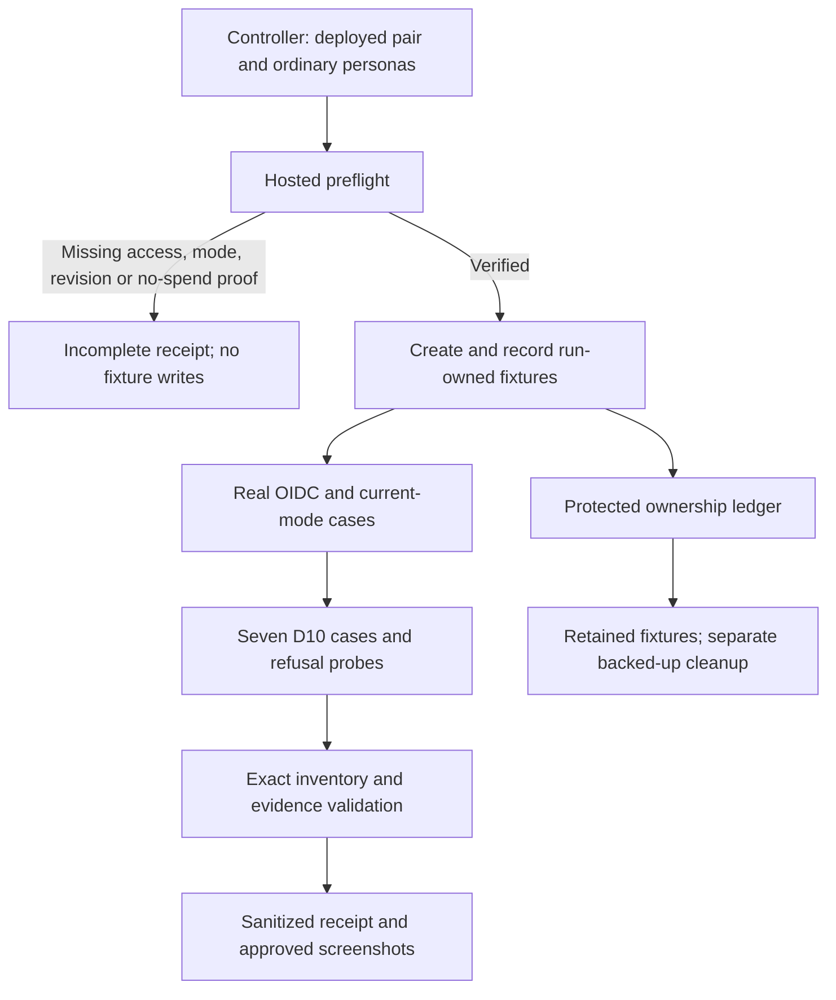
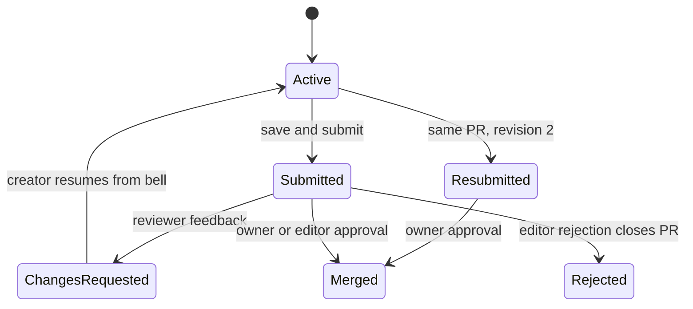

# OW-2 Hosted D08-D10 Persona UAT - Plan

## Goal Capsule

- **Objective:** Ordinary contributors and reviewers can complete the suggestion workflow on DEV, with recorded evidence of what works and what still prevents hosted acceptance before BAIF on November 5–6.
- **Means:** Adapt the existing D10 browser proof to a separate hosted entrypoint, add the applicable D08/D09 observations, and repair reproduced failures (KTD1–KTD4).
- **Authority:** The controller's `ow-2` mandate and supplied campaign rules, then this repository's `AGENTS.md` and the linked delivery plans. Campaign references are R11, R15–R20. The chief repository's `docs/plans/2026-10-26-0705-feat-codex-drawdown-campaign-plan.md` and `ops/drawdown/mandates/_common.md` are not mounted in this clone; their Goal Capsule and cited R-ID text were not independently read. The controller must reconcile those excerpts before build execution; the supplied rules govern this plan meanwhile.
- **Execution boundary:** This stage writes and commits the plan and its roadmap pointer only. The subsequent build uses `lfg` on this plan, on `drawdown/ow-2`; the controller scans, pushes and opens the PR targeting `dev`, and the campaign gate merges. The worker never adds a remote, seeks GitHub access or publishes directly (campaign R15, R17, R19).
- **Stop conditions:** No spend, credential discovery or reads, security-setting changes, sends, force-push, or deletion without verified backup (campaign R11). Missing hosted access blocks hosted assertions, not independent implementation and synthetic tests. No CTT choices, AWS provisioning, schema migration, data rewrite, release or outside service is part of this item.

---

## Product Contract

### Summary

Provide repeatable hosted persona UAT for the D08–D10 chain and fix failures it demonstrates.
Keep local regression evidence, observed DEV behavior and unavailable hosted prerequisites distinct.

### Problem Frame

The D10 handoff records merged and deployed code but explicitly leaves hosted persona acceptance open.
The later BAIF rehearsal also lacks a hosted run because verified DEV accounts were unavailable.
Without a current run, the demo team cannot tell whether real users can sign in, submit, resume and review edits on the serving deployment.

### Re-verified starting state

Source inspection on October 26 began at clean HEAD `43783d39e37f43b222516f737c4cff6837e5c547` on `drawdown/ow-2`, with no remote configured.
No tests, builds, hosted probes or credential reads ran during planning.

| Evidence | What it establishes | Remaining limit |
|---|---|---|
| `docs/handoffs/2026-10-03-d10-dev-uat.md`, present through `e6090b92` | Hosted chain and account-access blocker are documented | Current account availability is unknown |
| `docs/releases/d10-suggestion-chain-readiness.md` | Historical seven-case local proof; September 28 web `787eecc4` / API `44b6dfd3` deployment | Neither fresh test results nor current deployed revisions |
| `docs/handoffs/2026-10-20-sweep-cloud-ontokit-web.md`, changes through `43783d39` | Rehearsal and keep-both edit decision are already in this checkout | Named `origin/feat/baif-rehearsal-20261020` and `origin/docs/sweep-handoff-rehearsal-edits-20261020` refs are absent; their merged artifacts are available |
| `scripts/rehearsal/hosted.mjs` | Hosted launch precedent exists for three personas and four rehearsal cases | It stages CTT sources, records runner HEAD, inherits raw output and deletes runtime files; it is not the D10 runner |
| `e2e/fixtures/run.ts`, `e2e/fixtures/suggestions.ts`, `e2e/browser/suggestions.spec.ts` | D10 uses four personas, exact cases and real browser/API assertions | Loader accepts loopback only; fixtures delete projects and auth files automatically |
| `scripts/e2e/auth-lifecycle.mjs`, `e2e/browser/auth-lifecycle.spec.ts` | D08 uses short disposable provider lifetimes and an owned Next process clock | Cannot run unchanged on shared DEV |
| `e2e/browser/auth-mode-optional-configured.spec.ts` | Anonymous/public/private and sign-in flows exist | Depends on isolated seeding and volume cleanup; one DEV deployment cannot prove every mode |

The named `docs/d10-uat-handoff-20261003` branch is absent too; its handoff is present in HEAD.
No chief source, live revision, test success or account-readiness claim is inferred from missing refs.

### Requirements

**Hosted workflow**

- R1. Four distinct ordinary personas—owner, suggester, editor and unrelated non-member—complete real OIDC sign-in and application/provider sign-out, with the expected identity and access boundaries.
- R2. Preserve D10's seven journeys and refusal probes: submit to triage; owner approval and persisted merge; request changes and bell-driven same-PR revision-two resubmission; editor rejection; private/mint refusals; editor approval; public non-member submission.
- R3. Verify the currently deployed authentication mode, including anonymous public proposal submission and private-project isolation when DEV is optional with a configured provider; a mode mismatch remains an explicit incomplete prerequisite.
- R4. Record D08 renewal, refresh recovery and cookie-expiry coverage separately from login/logout; an unobserved boundary cannot be reported as hosted success.
- R5. Fix demonstrated failures within this web lane with regression coverage and coordinate API-owned failures with the API lane before rerunning the matched deployment.

**Evidence and preservation**

- R6. Every hosted result identifies its run, actual deployed web/API pair, runner revision, mode, mandatory cases, observed outcomes and fixture disposition; unknown prerequisites, failed cases and interruptions cannot produce accepted evidence.
- R7. All mutations stay within fresh run-tagged synthetic fixtures; retain data when verified backup is absent, including after partial setup or interruption.
- R8. Receipts, screenshots, plans and commits are public-safe: no credential material, real-person details, raw logs, private matter text or machine-local paths. The sandbox worker never reads credential files; an authorized controller performs credentialed execution outside it.
- R9. Existing tests and assertions remain intact. Any frontend fix has a Playwright screenshot of the changed page committed under `docs/plans/evidence/`, with its path reported at delivery (campaign R15–R16).
- R10. Progress only `ow-2`; apply the campaign's no-spend and other hard stops, preserve broader B02/B03/B11 remainders, and return access-dependent work without waiting on Damien through October 30 (campaign R11, R17, R20).

### Key Decisions

- **Existing suggestion permissions stand.** Editors approve and signed-in public non-members suggest at the untrusted tier, as confirmed September 28 in the D10 readiness receipt. Governs R2; no policy question remains.
- **Continue independent work through access blockers.** (session-settled: user-directed — chosen over waiting for Damien: zero user time through October 30.) Governs R5, R10.
- **No expansion in this branch.** The campaign chose guarded expansion merges over holding them for taste review, and durable hygiene over speculative features once eligible work ends. Neither changes this planned item's scope. Governs R10; expansion freeze November 3–6 remains campaign R18.

### Scope Boundaries

This is the hosted D08–D10 slice of B02/B03/B11, not acceptance of their entire catalog rows.
The [requirements catalog](../audits/2026-09-20-requirements-backlog.md) still owns trust promotion, translation/audit, quiet-period auto-accept and objections, operational restore/rollback, and broader deployment evidence.

#### Deferred to Follow-Up Work

- `ow-1` owns the FOLIO/Catholic OS rehearsal; `ow-3` owns notification-socket hardening. Reuse their existing primitives without advancing either item.
- The API/deployment lane owns any previously authorized Mailpit verb installation and backend fixes; the [September 30 plan](2026-09-30-ontokit-dev-mailpit-uat-plan.md) remains its contract.
- B13 recurring CI, multi-tab refresh locking, other roadmap areas, CTT choices and ALEA AWS remain outside this delivery.

No generic hosted-testing framework, new login service, whole-product permission audit or exhaustive private endpoint sweep is planned.
The existing D10 paths and D09 visibility/direct-access checks define the necessary coverage; expand only for a reproduced failure in those paths.

---

## Planning Contract

### Key Technical Decisions

- KTD1. **Separate target from test meaning.** Add a dedicated `scripts/e2e/hosted-suggestions.mjs` entrypoint and hosted-only supplemental spec. Reuse the seven D10 assertions through explicit hosted metadata in the suggestions fixture; preserve the isolated loader, profile inventories and D11 entrypoint. A URL override alone is invalid because the current loader rejects hosted suggestions and teardown assumes disposability. Governs R1–R3, R9.
- KTD2. **Preflight before fixture writes.** Require controller-supplied, timestamped evidence of the deployed web/API/worker pair, auth-mode agreement, four non-administrative personas and a submission/indexing path that cannot bill. Provider presence alone proves none of these. Confirm subjects and project memberships through normal authenticated behavior; do not set the ordinary-persona flag merely because four IDs differ. Missing proof stops hosted writes and records the specific prerequisite. Governs R1, R3, R6, R10.
- KTD3. **Retain hosted fixtures by default.** Record every created ID and ownership marker immediately in a protected run ledger that survives assertion failure and interruption. Hosted finalizers close browser/request handles but do not DELETE projects, remove accounts, prune volumes or recursively delete run files. Cleanup is a separate controller operation after verified backup covering the affected project, revisions, sessions, PRs and related data. Keep existing isolated assertions; do not reuse destructive teardown on DEV. Governs R7–R8.
- KTD4. **Observe the existing authentication policy.** Hosted sign-in/logout is mandatory for each persona. Observe access renewal and refresh recovery using real elapsed time and fresh browser-derived API credentials when their actual lifetimes fit the recorded run window; otherwise retain explicit not-observed results. Application-cookie expiry remains local-only until genuinely observed on DEV. Never shorten TTLs, shift shared clocks, forge cookies, switch modes or treat cleared cookies as expiry proof. Governs R1, R3–R4.
- KTD5. **Publish allowlisted evidence only.** Capture child output privately instead of inheriting Playwright output. Emit fixed failure codes and case/probe facts; validate exact inventories, including case detail, before writing a hosted receipt. Keep runner HEAD separate from runtime revisions. Screenshots capture controlled post-login product UI, mask identity/other notifications before capture, and receive visual inspection before commit. Raw reports and auth state remain outside Git. Governs R6, R8–R9.
- KTD6. **Keep publication with the controller and work on Astra.** (session-settled: user-directed — chosen over the Sol-first ladder: the campaign specifies Astra.) The local branch is the delivery artifact; the controller and campaign gate own publication and merge. Governs R10 and the Goal Capsule execution boundary.

### High-Level Technical Design

The hosted entrypoint supplies validated run context to shared D10 journeys and hosted-only identity/mode cases, then validates their results into a public-safe receipt (KTD1–KTD5).

The existing D10 transition contract is preserved; outcomes and notification navigation are assertions, not new product states (R2).

### Assumptions and External Prerequisites

| Item | Evidence or assumption | Owner and effect |
|---|---|---|
| Campaign excerpt | Chief Goal Capsule and R11/R15–R20 absent locally | Controller supplies/reconciles before build; no worker credential or remote discovery |
| Verified personas | Historical Mailpit restriction persists in the latest handoff; current installation is unknown | Controller/API lane supplies execution using existing authorization; do not reopen the access-policy decision |
| Hosted mode | September 28 evidence says optional with Zitadel; current mode is unknown | Controller attests current web/API agreement before selecting the exact inventory |
| Runtime revisions | Local branch contains newer changes than last deployment receipt | Controller records serving revisions before and after UAT; moving deployment invalidates acceptance |
| No paid validation | D10 isolated tests use verification provider `none`; hosted billing behavior is unknown | API lane proves import/index/save/submit are non-billing for these fixtures before writes; no quota reset or privilege escalation |
| Browser-capable runner | This clone lacks credentials/remotes and denies Unix sockets | Controller runs hosted and full-stack gates in a suitable existing environment and returns sanitized evidence |
| Expiry observation | Real provider lifetimes and observation duration are execution-time facts | Record a finite window before running; unobserved required boundaries stay open under R4 |

After the controller reconciles the campaign excerpts, missing hosted-access and execution prerequisites do not prevent implementing the runner, validator and tests with synthetic data.
They do prevent a claim that hosted UAT passed.
If a dependency truly requires a new user decision after existing authority is checked by the controller, report what is needed, setting, estimated minutes and what it unblocks under `Needs your decision` (campaign R20).

### Coverage Boundaries

| Source obligation | Hosted observation | Acceptance limit |
|---|---|---|
| D08 R1 | Four personas log in, perform protected reads, sign out, and require provider interaction on next login | Mandatory hosted cases |
| D08 R2 | Genuine access expiry followed by renewal and protected read as the same subject | No early renewal or login/logout substituted for expiry |
| D08 R3 | Naturally unusable refresh grant triggers SessionGuard and preserves original URL/query | Longer-than-window lifetime means not observed |
| D08 R4 | Genuine application-session expiry | Controlled Next-clock proof remains isolated; hosted coverage stays open until observed |
| D09 configured mode | Public visibility, private list/direct denial, original-URL sign-in return, owned-private access, anonymous proposal when optional | Other deployment modes keep their isolated evidence only |
| D10 R1–R10 | Existing seven cases with exact probes, merged source/index/UI agreement and decision notifications | No administrator persona or skipped case can satisfy them |
| D10 R11 | Anonymous save/submit appears in owner triage in actual optional-configured DEV | Required/disabled/providerless DEV does not close this case |
| D10 R12 | Existing isolated integrity preserved; hosted provenance, inventory and retention recorded separately | Retention is not reported as completed cleanup |

---

## Implementation Units

### U1. Establish the hosted target and evidence boundary

**Goal:** Run only the intended hosted matrix with validated prerequisites and honest failure receipts.
**Requirements:** R6–R10; KTD1–KTD3, KTD5–KTD6.
**Dependencies:** Campaign reconciliation before build; no hosted-access prerequisite for synthetic implementation. Listed external prerequisites apply before hosted writes.
**Files:** New `scripts/e2e/hosted-suggestions.mjs`, `scripts/e2e/hosted-suggestions.test.mjs`, `__tests__/e2e/hosted-run-config.test.ts`; extend `e2e/fixtures/run.ts`, `scripts/e2e/evidence.mjs`, `scripts/e2e/evidence.test.mjs`, `playwright.config.ts`, `package.json` as needed for the separate entrypoint.

**Approach:**

1. Model hosted suggestions explicitly while preserving existing loopback validation and isolated profile ownership. Add a distinct hosted command; do not repurpose `test:e2e:suggestions` or `rehearsal:hosted`.
2. Accept the authorized controller's target and provenance through a protected execution boundary modeled on the existing hosted launcher. The lane develops and tests this with synthetic input only; it never opens a real target/auth-state file.
3. Implement KTD2's preflight, KTD3's ownership ledger and KTD5's fixed receipts. Distinguish preflight-incomplete, executed-failed, interrupted and passed results without fabricated zero failure counts.

**Patterns:** `scripts/rehearsal/rehearsal.test.mjs` dependency injection, `scripts/e2e/evidence.mjs` exact inventories, `scripts/e2e/ownership.mjs` private paths.
**Execution note:** Characterize isolated validation before adding hosted acceptance; start with synthetic failure cases.
**Test scenarios:**

1. Four distinct synthetic personas and approved HTTPS target produce the expected hosted run; three personas, duplicate subjects, malformed origins and hosted/isolated confusion fail before writes.
2. Missing ordinary-persona, mode, runtime or no-spend evidence prevents project import and produces an incomplete receipt.
3. Empty, duplicate, missing, skipped, retried, flaky or wrong-profile cases cannot produce hosted acceptance; runtime changes during a run invalidate it.
4. Sentinel secrets and personal details in malformed target data, assertion errors and raw child output never reach receipts or public output.
5. Setup failure, failed assertion and interruption preserve the owned-resource ledger and invoke no hosted deletion; runner HEAD never substitutes for deployed HEAD.

**Verification:** New validator/runner tests and existing evidence/profile tests pass with unchanged original expectations.

### U2. Observe hosted identity and the active auth mode

**Goal:** Establish the real user and authentication context for the review chain.
**Requirements:** R1, R3–R4, R6–R9; KTD2–KTD5.
**Dependencies:** U1; external prerequisites for live execution.
**Files:** New `e2e/browser/hosted-personas.spec.ts`, `e2e/fixtures/hosted-personas.ts`, `__tests__/e2e/hosted-personas.test.ts`; extend `scripts/e2e/hosted-suggestions.test.mjs`, `scripts/e2e/evidence.mjs`, `scripts/e2e/evidence.test.mjs`; narrow shared-helper changes in `e2e/fixtures/auth.ts` or `e2e/fixtures/auth-lifecycle.ts` only when required.

**Approach:** Reuse browser actions and response observations without importing lifecycle setup, clock control, container seed or teardown. Keep supplemental hosted cases out of isolated inventories. Resolve the actual-mode inventory before execution, and record unavailable expiry observations in a separate coverage ledger rather than Playwright skips.
**Patterns:** D08 flow recorder and protected settings read; D09 resolved-session landmarks, denial probes and original-URL return.
**Test scenarios:**

1. Each of four fresh persona contexts completes interactive sign-in, protected access, full logout and another interactive sign-in without cross-persona state.
2. HTTPS session-cookie recognition includes secure prefixes/chunks while preserving loopback behavior; no raw cookie value enters diagnostics.
3. Anonymous and unrelated users cannot discover or read the run-owned private fixture; sign-in returns to the requested URL and unrelated access remains denied. The owner can access that same fixture.
4. Actual optional-configured DEV permits an anonymous proposal to reach owner triage; a different or unknown mode yields the recorded incomplete scope without changing configuration.
5. A naturally observed access expiry renews without interactive login; a naturally expired refresh grant recovers to the original URL. Insufficient observation duration cannot satisfy either case or cookie expiry.
6. Long-running observations obtain fresh API credentials through the genuine browser session, preventing stale setup tokens from causing false product failures.

**Verification:** Supplemental cases and evidence validator agree on outcomes; unchanged D08/D09 isolated inventories remain mandatory in an execution-capable environment.

### U3. Run the D10 journeys without destructive hosted teardown

**Goal:** Carry the existing review-chain proof onto DEV with the same assertions.
**Requirements:** R2, R5–R9; KTD1–KTD3, KTD5.
**Dependencies:** U1 and verified personas; U2's hosted observations accompany acceptance.
**Files:** `e2e/browser/suggestions.spec.ts`, `e2e/fixtures/suggestions.ts`, `e2e/fixtures/run.ts`; new `__tests__/e2e/hosted-suggestion-fixtures.test.ts`; extend `scripts/e2e/evidence.test.mjs`.

**Approach:** Separate shared D10 journey assertions from hosted fixture disposition. Create only tiny synthetic ontology projects, record IDs immediately, add roles through the owner HTTP API, and prove the unrelated account is not a member. Preserve every original test, assertion and probe. Apply KTD3 to project and auth-file finalizers; keep immutable public evidence separate from protected runtime state.
**Patterns:** Existing suggestion helpers, `e2e/fixtures/tiny-ontology.ttl`, bounded notification/index polling and strict `SUGGESTION_CASES`.
**Test scenarios:**

1. Submit reaches triage; post-submit saves and suggester review are refused at the API with the existing statuses.
2. Owner approval persists the exact label in source, index and reloaded UI, removes the suggestion branch and notifies the suggester; completed-state actions and self-approval are refused.
3. Request changes reaches the bell; resume adopts the server branch; save/resubmit keeps the same PR and increments revision; approval merges the new revision.
4. Editor rejection closes its PR and notifies the suggester; editor approval succeeds on another user's suggestion.
5. Private non-member creation and untrusted minting remain refused; public non-member capabilities match actual successful submission.
6. Success, failure after import, membership failure and interruption retain every hosted fixture without affecting preexisting projects; isolated cases retain their original behavior.

**Verification:** The exact seven D10 cases and all original probes pass on the selected pair; missing outcomes remain incomplete.

### U4. Repair observed failures and land the acceptance record

**Goal:** Resolve failures in scope and leave a revision-bound account of hosted acceptance and its limits.
**Requirements:** R4–R10; KTD4–KTD6.
**Dependencies:** U1–U3 for complete hosted acceptance; local regressions can proceed from reproducible evidence while access is blocked.
**Files:** New `docs/plans/evidence/2026-10-26-ow-2-hosted-uat.md` and sanitized per-run JSON there; screenshots under `docs/plans/evidence/`; update `docs/releases/d10-suggestion-chain-readiness.md` and `docs/plans/2026-09-20-0649-requirements-delivery-roadmap.md`. Conditional fixes only in the demonstrated owner, such as `app/projects/[id]/editor/page.tsx`, `lib/hooks/useSuggestionSession.ts`, `components/auth/SessionGuard.tsx` or suggestion review pages, with their matching tests in `__tests__/app/suggestion-review.integration.test.tsx`, `__tests__/app/suggestion-history.integration.test.tsx`, `__tests__/lib/hooks/suggestion-scope.integration.test.tsx` and `__tests__/components/auth/SessionGuard.test.tsx`.

**Approach:**

1. Classify failures as unavailable prerequisite, fixture/runner defect, web defect or API defect. Reproduce before changing product code; record API cases for the paired lane with expected/actual contract and safe evidence.
2. Add the regression at the failing boundary, repair it, simplify and review the focused diff, then have the controller deploy the reviewed compatible pair and rerun affected hosted journeys.
3. Capture R9 screenshots for every changed frontend page, review them for R8, and retain their repo-relative paths in the receipt. Record all attempted outcomes, actual revisions, expiry limits and retained-fixture disposition.
4. Update only the `ow-2` pointer and relevant D08–D10/B02/B03/B11 evidence. Preserve previous receipts and the remaining catalog obligations.

**Test scenarios:**

1. A demonstrated web failure has a regression that fails before its fix and passes afterward without relaxing existing assertions.
2. A deployment change or unavailable persona prevents accepted evidence even if local tests pass.
3. The final receipt contains every required case/probe outcome and screenshot link, with no secrets or real-person data; unresolved expiry cases remain open.

**Verification:** Required local gates pass, code review is resolved, frontend evidence is committed where applicable, and hosted claims match actual controller-run results. No speculative fixes are required when the original behavior passes.

---

## Verification Contract

No runtime verification is part of the plan stage.
The build stage uses the repository's existing commands and adds only the focused hosted-runner test entrypoint from U1.

| Gate | Applies to | Required result |
|---|---|---|
| `npm run type-check`, `npm run lint` | All implementation changes | No new errors |
| `npm run test -- --run` | New fixture tests and any production fix | Existing suite remains green; no tests removed or weakened |
| `npm run test:e2e:evidence`, `npm run test:e2e:profiles`, `npm run test:e2e:ownership`, `npm run test:e2e:identity` | Shared harness changes | Original boundaries and exact inventories preserved |
| New hosted-runner unit tests | U1–U3 | Positive path, prerequisite refusal, no deletion and redaction cases pass using synthetic data |
| Existing baseline, lifecycle, mode and suggestions browser profiles | Shared fixture/auth changes | Same mandatory inventories pass in a suitable isolated runner; observe backup requirements before destructive cleanup |
| Controller-run hosted matrix | U2–U4 | Real serving pair, ordinary personas, all selected mandatory cases and fixed probes, no skips/retries, honest coverage ledger |
| Playwright screenshots | Any frontend fix | Changed page captured, visually checked and committed under `docs/plans/evidence/`; no credential screens |
| Receipt and diff review | Delivery | Public-safe artifacts, no unrelated edits, no invented live success, retained data disposition explicit |

Unix-socket failures or unavailable browser/full-stack prerequisites are environment limitations, not passing checks.
The controller supplies that execution environment; the worker does not bypass the sandbox or obtain credentials.
No package release or `release:validate` step applies: this repository has no such script and this item authorizes no release.

---

## Definition of Done

- U1–U3 are implemented and independently reviewed, with the verification gates appropriate to the changed code passing.
- U4 closes reproduced failures, commits required frontend screenshots and supplies a truthful hosted receipt against the final deployed pair.
- Hosted chain acceptance requires the four-persona lifecycle entry/exit, actual-mode coverage and all seven D10 cases. D08 expiry obligations are closed only when individually observed; any still-required unobserved boundary keeps full D08–D10 acceptance partial.
- Unavailable access, provenance, mode or no-spend proof produces a concrete incomplete receipt and controller handoff, never a completed `ow-2` claim. Broader B02/B03 requirements remain open unless independently proven.
- Retained hosted fixtures and private run state have an explicit ownership/disposition record. Nothing is deleted without verified backup; abandoned experimental implementation does not remain in the delivery diff.
- The roadmap links the plan and evidence and states the remaining blocker and next action. The branch contains only this item, ready for controller publication to `dev` under the campaign gate.
