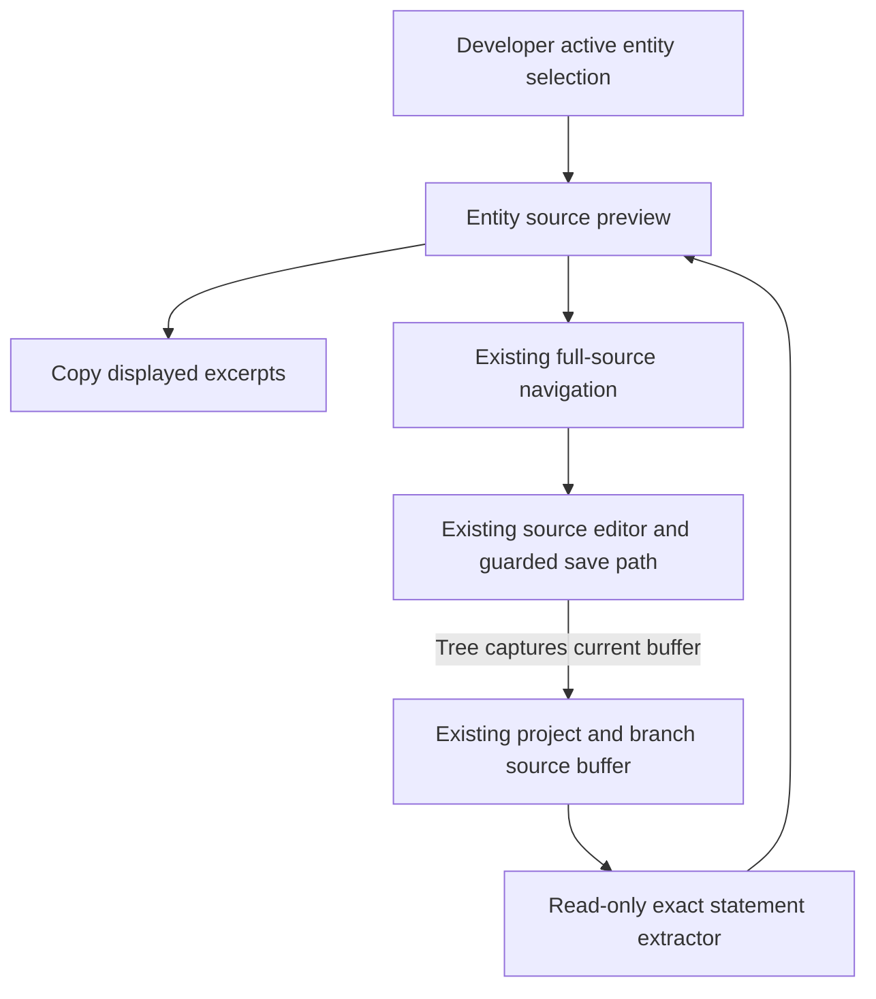
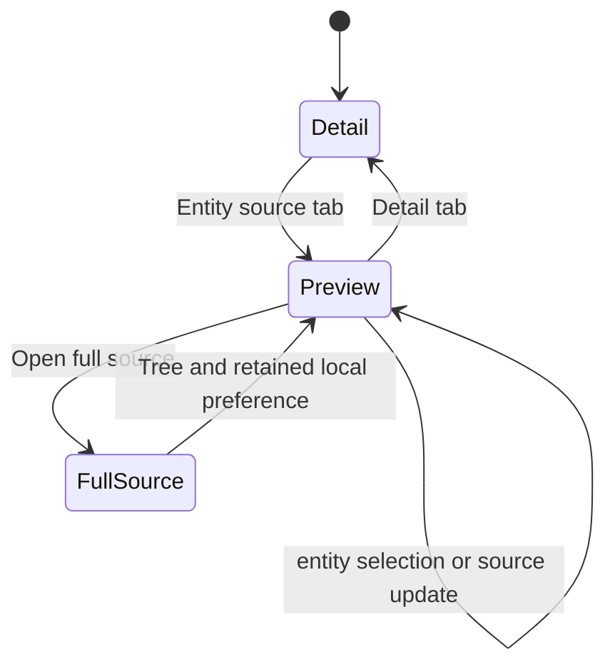

# Ow4 entity source preview - Plan

## Goal Capsule

**Objective:** A presenter or contributor can inspect and copy the Turtle statements for a selected FOLIO or Catholic OS entity without leaving the entity tree.

**Means:** Deliver the read-only entity-source portion of A04/B27, using the existing Developer layout and source buffer (KTD1–KTD4). Reconcile the delivery roadmap against the current checkout before treating queued work as missing (R1).

**Authority:** The controller's `ow-4` mandate and campaign instructions govern this item; repository `AGENTS.md`, the [delivery roadmap](2026-09-20-0649-requirements-delivery-roadmap.md), and the [requirements catalog](../audits/2026-09-20-requirements-backlog.md) govern repository work. The chief-repo authority is `docs/plans/2026-10-26-0705-feat-codex-drawdown-campaign-plan.md`, Goal Capsule and campaign R11/R15–R20. That file and `ops/drawdown/mandates/_common.md` are absent from this isolated clone; their full text was not inspected. This plan applies the campaign rules supplied by the controller and leaves their source comparison to the controller before the build dispatch.

**Execution boundary:** This is one **planned** item on `drawdown/ow-4`. The current stage commits documentation only. A later build stage runs `lfg` on this plan, implements and reviews the change, and commits locally. The controller scans, pushes and opens the PR targeting `dev`; the campaign merge gate handles merging. Do not add a remote, seek a GitHub login or search for credentials.

**Stop conditions:** Do not cross campaign R11 or add a schema migration, data rewrite, package release, outside service, spend, credential/security-setting change, message in Damien's voice, unbacked deletion or force-push. CTT namespace/quotation decisions and ALEA AWS provisioning are outside this item. A missing browser/runtime prerequisite remains an explicit verification gap, never a passing receipt.

---

## Product Contract

### Summary

Add a `Detail | Entity source` selector to the right pane while the Developer layout is in Tree mode. The source preview follows the selected class, property or individual, shows exact source excerpts and line context, supports copying, and opens the existing full-source editor.

### Problem Frame

The roadmap still labels several integrated changes as queued or awaiting publication. Its next-action text also points at B12 work already present in this checkout. Choosing from those labels alone would repeat work owned by other drawdown items.

The current Developer layout offers whole-workspace Tree, Source and Graph modes. Inspecting an entity's Turtle takes the presenter away from the tree. B27 already calls for entity-scoped source, and the historical Phase17 context explicitly permits source/tab groundwork before the graph API work lands. An additive preview addresses that gap without changing the graph or submission workflow before BAIF.

### Requirements

**Delivery reconciliation**

- R1. Record an evidence-based disposition for all twelve roadmap areas, retaining B01–B75 and the catalog's deferred, conditional and superseded distinctions. Separate source integration, historical test receipts and hosted acceptance.

**Entity source preview**

- R2. In Developer Tree mode, provide accessible `Detail` and `Entity source` tabs for the right pane; start on Detail and retain the choice while the same layout remains mounted.
- R3. The preview follows the active class, property or individual selection and the current project/branch source buffer. It must never show another entity's or branch's excerpt under the selected IRI.
- R4. Show the selected IRI and every supported, directly stated subject statement in source order, preserving its original text and displaying a one-based source line for each excerpt. Object references and similarly named IRIs are not subject definitions.
- R5. `Copy snippet` copies the displayed excerpts with their file/line comments and reports clipboard failure truthfully. `Open full source` uses the existing full-source navigation path for the selected IRI.
- R6. Distinguish no selection, loading, load failure with retry, and unavailable/unsupported source. Missing local statements keep `Open full source` available; incomplete text is not presented as a complete definition.

**Compatibility and proof**

- R7. Previewing must preserve unsaved detail-form state and the existing Source→Tree buffer capture, graph navigation, save/conflict handling and permissions. The preview adds no write operation and does not synthesize unsaved form fields into Turtle.
- R8. Add focused tests and committed Playwright screenshots of the changed page under `docs/plans/evidence/`; preserve every existing test and its behavioral assertions. Record actual pass/fail and environment limits, with no hosted-acceptance claim from mocked browser proof.

### Scope Boundaries

This slice covers the B27 excerpt/copy/line-context capability and existing full-source navigation. B27 remains **partial** until its modal/maximize/restore and overlay-selection behavior are delivered. B25 remains open: this additive selector is not the final cross-mode `Detail | Graph | Source` workspace.

Existing Standard mode, Developer Tree/Source/Graph mode buttons, class source actions, tree context menus and graph click behavior stay intact under R7. No changes to source serialization, ontology content, auth policy, paid LLM calls or API contracts are required.

#### Deferred to Follow-Up Work

- B24 and B26: reconcile the server graph port and coordinate meaningful property/individual neighborhoods with `ontokit-api`.
- B25: the final workspace tabs, shared entity header, strip alignment, session-wide tab preference and replacement of old affordances.
- B27 remainder: full-source modal, maximize/restore and overlay selection synchronization.
- `ow-1`/`ow-2`/`ow-3`: hosted rehearsal, hosted D08–D10 acceptance and socket proof. `ow-5`/`ow-6`: general demo polish, accessibility audit, dependency audit and wider rehearsal coverage.
- Other catalog candidates remain in their existing areas; this selection does not activate them.

#### Considered and Not Built

- A new source editor/model: the existing buffer and save path already own edits; a second writer would introduce synchronization risk.
- A new worker, generalized RDF parser or graph transport: current statement utilities support this read-only slice. Reconsider only if targeted fixtures or browser evidence demonstrate an unmet requirement.
- Recursive expansion of linked blank-node statements, imports or inferred axioms: the preview is an excerpt of direct statements in the current file. Full source remains the place to inspect linked structures.

### Acceptance Examples

- AE1. **Covers R2–R4:** Select a class, choose Entity source, then select a property and an individual. The tree stays visible, the selected IRI and excerpts follow each selection, and returning to Detail restores that entity's form.
- AE2. **Covers R4–R6:** A subject has two declarations, including one after another subject on the same line. Only the selected subject's exact statements appear, each with its own start line. An IRI occurring solely as an object yields unavailable source.
- AE3. **Covers R5/R7:** Open full source from an excerpt, edit through the existing source editor, then return using Tree. The existing buffer-capture behavior runs and the preview reflects that buffer; it does not save on its own.
- AE4. **Covers R6/R7:** Enter an unsaved form value, switch to Entity source and back. The value survives. The preview reflects the source buffer, not an invented serialization of that pending form input.

---

## Planning Contract

### Re-verified Starting State

Baseline: clean `drawdown/ow-4` at `43783d39e37f43b222516f737c4cff6837e5c547`, inspected on 2026-10-26. Local history is not shallow. The named remote branches are unavailable; the local history contains their integrated changes. No application tests, builds, browser runs or hosted probes ran during this planning stage.

| Local evidence | Conclusion and limit |
|---|---|
| `f3228d7b` (PR68), `e2e/browser/rehearsal.spec.ts`, `docs/handoffs/2026-10-20-sweep-cloud-ontokit-web.md` | Rehearsal code is integrated. The handoff reports isolated-stack success; DEV persona/rehearsal acceptance is separate `ow-1` work. |
| `43783d39` (PR69), the same handoff | The keep-both rehearsal-edit decision is integrated. CTT namespace and quotation questions remain untouched. |
| `0617a1e1` (PR67), `lib/api/notificationSocket.ts`, `docs/releases/b12-web-notification-readiness.md` | Web socket hardening is integrated. API recovery and live acceptance remain `ow-3`; presence/editing synchronization was explicitly excluded. |
| `06088bed` (PR70), `components/hydration-review/`, `docs/plans/2026-10-20-hydration-review-viewer-plan.md` | The B34 hydration review slice exists. It does not establish the B28–B33 producer-to-reviewed-change loop. |
| `3192447b` (PR65), `lib/ontology/turtleUtils.ts`, `e2e/browser/editor-data-integrity.spec.ts` | Later editor/Turtle repairs are integrated; the September catalog's parser findings require fresh reconciliation. Do not weaken these repairs for excerpts. |
| `DeveloperEditorLayout.tsx` under `components/editor/developer/`, `lib/stores/selectionStore.ts` | Whole-workspace modes exist; no entity-source preview or pane-tab state exists. |

### Area Reconciliation and Selection

This is a selection audit, not a declaration that every historical requirement was re-tested. The build must refresh it if its starting revision changes.

| Area / IDs | Evidence-backed disposition at this baseline | Action for `ow-4` |
|---|---|---|
| A01 / B01–B09 | D01–D10 integration and deployment receipts exist; D11 is integrated. Hosted acceptance and external activation remain distinct. | Preserve those limits; hosted proof belongs to `ow-1`/`ow-2`. No provisioning. |
| A02 / B10–B15 | Harness and auth/suggestion profiles exist. B12 web code and later B15-related repairs are integrated. `release.yml` runs harness unit tests; browser config is Chromium with traces off, not proof of all B13 outcomes. | Correct the stale B12 next-action/publication text. Keep B11 multi-tab, B13 and B14/B15 remainders open. |
| A03 / B16–B23 | Current `lib/api/suggestions.ts` and suggestion components provide whole-session review, not shard review. Source-index S0217 describes five then-unbuilt API endpoints; current API implementation is not available here. | Higher roadmap priority, but no verified backend contract for a safe web-only slice. Resume after API contract evidence; do not revive phantom endpoints. |
| A04 / B24–B27 | Current graph is a repaired client-side class graph. Source buffer, typed selections and exact statement utilities exist; entity preview is absent. | **Select B27 source preview.** It improves real-ontology inspection using existing contracts. Record B24–B27 partiality and all eleven historical requirements below. |
| A05 / B28–B34 | B34 local hydration review is integrated; a current general import client/queue is absent from `lib/api/` and `components/`. | Preserve B34 partial integration; producer contracts and human-reviewed write-back remain separate. |
| A06 / B35–B38 | Trust controls and `CommitIdentityCard.tsx` exist. Catalog distinguishes deferred contributor-standing/public-credit work from activation and email verification. | No identity provisioning or promotion of deferred candidates. |
| A07 / B39–B46 | LLM settings, usage and generation surfaces exist; embedding settings still save `MODEL_DEFAULTS[provider]`. | Keep the precise follow-ons; model/rebuild/provider choices provide less immediate demo value and require separate scope. |
| A08 / B47–B49 | `lib/api/translations.ts` and translation settings exist. The catalog treats automatic maintenance and long-form defaults as candidates/policy changes. | Preserve existing lifecycle; no automatic paid work. |
| A09 / B50–B55 | Catalog explicitly rejects stub completion and the old owlready2 architecture. Existing cross-references are not a formal reasoner or restriction viewer. | Retain user outcomes without reviving superseded tooling. |
| A10 / B56–B58 | Hosting/topology plans exist; current ownership, destinations and hosted state cannot be verified from this clone. | Retain activation boundaries; AWS and new services are out of scope. |
| A11 / B59–B62 | D11 records real-ontology timings, not the requested 50K+ benchmark or a storage decision. | Keep measurement first; no storage rewrite. |
| A12 / B63–B75 | Graph, shortcut and review surfaces already exist; remaining polish/maintenance requires current findings. B73 benefits from this reconciliation. | Update the tracker; leave general polish/hygiene to `ow-5`/`ow-6`. No branch deletion. |

The selection advances around A03's unverified cross-repo prerequisite, as the roadmap permits. Its return condition is verified API contract/readiness evidence for a bounded shard or reviewer increment. It does not reorder the rest of the program or declare A04 complete.

### Historical Phase17 Preservation

The [source index](../audits/2026-09-20-requirements-source-index.md) preserves S0133, S0137 and S0141 as readable immutable Git blobs. S0137 D08 permits frontend Source/tab work before API integration. Its assumptions about `EntityGraphModal`, a server graph client, and graph click behavior do not match this checkout; those components/semantics must not be imported by name without reconciliation.

| Phase17 requirement | Disposition in this slice |
|---|---|
| 1: final right-pane tabs, persistent header, strip alignment | Deferred B25; additive Developer selector only. |
| 2: remove Developer peer mode strip | Deferred B25; current mode controls retained. |
| 3: remove Standard graph icon | Deferred B25. |
| 4: remove old source links | Deferred B25/B27; current entry points retained. |
| 5: single-click recenter, double-click selection | Deferred B24/B25; current single-click navigation/double-click expansion retained. |
| 6: session-wide tab persistence and mode fallback | Deferred B25; local mounted-layout preference only. |
| 7: entity Turtle snippet, copy, line comment | B27 capability delivered by R3–R6; final three-tab placement remains B25. |
| 8: first-open Detail default | Applied to the additive preview under R2; global workspace behavior remains B25. |
| 9: full-source modal/maximize/restore | Deferred B27. |
| 10: selection-synchronized snippet and overlay | Snippet covered by R3; overlay portion deferred B27. |
| 11: property/individual graph backend and annotation empty state | Deferred B24/B26 with API lane. |

### Key Technical Decisions

- KTD1. **Add the preview without relocating existing modes.** Keep the existing detail panel mounted while its preview is visible so changing tabs does not discard local form state (R2/R7). A local Developer-layout selector is sufficient; do not add persistent preferences, URL state or a global pane-store migration.
- KTD2. **Extract exact statements without changing writers.** A new read-only helper composes `iterateStatements`, `iriTurtleForms` and subject matching in `lib/ontology/turtleUtils.ts`. Use scanner offsets for excerpt text and line numbers; `findBlock` returns only the first line-aligned block and is unsuitable alone (R4). Preserve shared writer behavior and treat unresolvable declarations or incomplete statements as unavailable rather than guessing.
- KTD3. **Copy source excerpts, not a reserialized ontology.** Each displayed segment is prefixed with `# File: <actual ontology file>, line N`; copy includes those comments and segment text in file order (R4/R5). Pass the current project ontology path as display metadata, with an honest generic file label when unknown. The excerpt need not be a standalone Turtle document; no fabricated prefixes or recursive axiom expansion.
- KTD4. **Reuse source ownership and navigation.** Developer selection determines the IRI from its active entity-type tab. Read the existing source props, use its loading callback, and delegate full-source opening to `handleNavigateToSource` (R3/R5–R7). Expose successful-load and scope metadata from the existing source owner where needed; a nonempty string alone cannot establish readiness. Scope includes the effective project, branch and ontology file, including suggestion branches. Keep buffer capture, source revision guards and source navigation callbacks intact. Prevent repeated automatic loads for a legitimately empty file; retry remains explicit after failure.
- KTD5. **Separate browser presentation proof from backend acceptance.** A standalone Playwright UI configuration may serve the actual app with deterministic, synthetic API/session responses for this one page test (R8). It must not add a production test route, weaken middleware or contact a real identity provider. Existing full-stack profiles remain the regression/real-backend proof path when their runtime is available.
- KTD6. **Use the campaign's authorized delivery path.** Build and review on Astra (session-settled: user-directed — chosen over a Sol-first ladder: the campaign fixes the execution model). The controller publishes the locally reviewed branch; no work in this item waits for Damien through 2026-10-30 (session-settled: user-directed — chosen over blocking on his availability: the campaign provides no user time in that window).

### Source Flow

The first diagram describes data ownership; the second describes the new selector's lifecycle. Existing Graph and other full-source entry paths keep their current behavior.

### Assumptions and Verification Limits

- The highest-value eligible web-only increment is source inspection; this is the planner's prioritization judgment under `ow-4`, not a new user-approved product direction.
- No live DEV, remote branch, API checkout or chief campaign-source state is inferred from the local Git history. The controller must compare the missing campaign source before build dispatch and supply current paired API provenance for any full-stack execution.
- Browser/Docker execution may be restricted by denied Unix sockets. The build can still implement and run supported unit/static checks; the screenshot and full-stack gates remain visibly incomplete until an authorized runner produces real evidence. No new login or service is required by the feature.
- Existing full-source IRI scrolling uses its current index/fallback. This slice adds exact attribution to the preview and preserves that path; it does not claim to solve B68 source-navigation refinements.

---

## Implementation Units

### U1. Reconcile roadmap evidence and retain the remaining queue

**Goal:** Make the selected B27 increment and already-integrated branches discoverable without overclaiming acceptance.

**Requirements:** R1. **Dependencies:** none.

**Files:** `docs/plans/2026-09-20-0649-requirements-delivery-roadmap.md`; this plan; `docs/plans/evidence/2026-10-26-ow-4-source-preview-readiness.md` (build receipt).

**Approach:** Use the area and Phase17 matrices above. Correct stale current-next-action language, add D12 for this slice, and link B27/B73 to the plan. Retain B01–B75 exactly once in the ledger and preserve all partial/deferred distinctions. Refresh the baseline if other lanes move it; after build, replace planned status with only the evidence actually achieved.

**Patterns to follow:** The roadmap's deliverable register and dated readiness receipts.

**Test expectation:** No application behavior in this unit; check links, ID retention, contradictory next-action text and integration-versus-acceptance wording.

**Verification:** The tracker identifies one actionable `ow-4` build, its remaining acceptance gates, and the return condition for A03.

### U2. Extract read-only entity source excerpts

**Goal:** Return exact matching source segments for any selected entity type without modifying Turtle.

**Requirements:** R3/R4/R6. **Dependencies:** U1.

**Files:** `lib/ontology/entitySource.ts` (new); `__tests__/lib/ontology/entitySource.test.ts` (new). Read `lib/ontology/turtleUtils.ts` and existing `__tests__/lib/ontology/turtleUtils.test.ts` as patterns; do not change writer semantics.

**Approach:** Follow KTD2/KTD3. Return source-order segments and one-based start lines from exact offsets, plus an unavailable result for unsupported/incomplete attribution. Memoize by actual source and selected IRI in the consumer; avoid rescanning on unrelated renders.

**Execution note:** Establish the source-fidelity fixtures before implementing the helper.

**Test scenarios:**

1. Extract class, object/data/annotation property and individual statements using full, prefixed, default-prefix and supported base-relative IRIs.
2. Cover AE2: repeated subject statements, two subjects on one line and CRLF input preserve exact selected statement bytes and correct line numbers.
3. Exclude object-only references, comments, literal mentions and the same local name in a different namespace.
4. Preserve nested blank nodes, collections, multiline strings and punctuation inside strings within a selected statement.
5. Empty/imported-only entities, incomplete statements and unsupported/ambiguous declarations do not yield misleading excerpts; inline linked structures are retained without following external blank nodes.
6. Extraction never mutates the source and has no network or save side effect.

**Verification:** New fixture tests pass alongside the existing Turtle parser/updater/remover suites.

### U3. Add the Developer entity source preview

**Goal:** Let users inspect the selected entity while retaining their tree context and editing state.

**Requirements:** R2–R7, AE1/AE3/AE4. **Dependencies:** U2.

**Files:** `components/editor/EntitySourcePreview.tsx` (new); `components/editor/developer/DeveloperEditorLayout.tsx`; `app/projects/[id]/editor/page.tsx` for source metadata plumbing; `lib/hooks/useProjectViewer.ts` only for the source-readiness/scope seam in KTD4; `__tests__/components/editor/EntitySourcePreview.test.tsx` (new); `__tests__/components/editor/DeveloperEditorLayout.integration.test.tsx`; `__tests__/components/editor/developer/DeveloperEditorLayout.test.tsx`; `__tests__/lib/hooks/useProjectViewer.test.ts` and `__tests__/lib/hooks/useProjectViewer.integration.test.tsx` when that seam changes.

**Approach:** Add a keyboard-accessible tab selector using existing styles and installed tab primitives. Keep the current form mounted but hidden/inert while previewing; preserve the existing keyed remount when the entity changes. The preview has its own IRI/context header, read-only excerpts, copy feedback and full-source action. Follow KTD1/KTD4; do not refactor shared graph/detail headers or create another editable Monaco model.

**Patterns to follow:** Developer source preload/loading/retry and `handleNavigateToSource`; `EntityTabBar.tsx` styles; existing copy/toast behavior; current source-buffer and revision ownership in `lib/hooks/useProjectViewer.ts`.

**Test scenarios:**

1. Cover AE1 across all entity-type selections, including clearing selection; no stale class source under a property or individual IRI.
2. Detail is the initial tab; switching entity retains preview while mounted; a fresh layout returns to Detail. Existing global Source button queries remain unambiguous.
3. Cover AE4: unsaved form values survive preview toggles without triggering the detail panels' save-on-unmount cleanup, and hidden fields do not remain keyboard-focusable. Existing autosave may still complete normally.
4. Loading/preloading suppress stale excerpts; one failed load exposes retry; empty successful source does not trigger an automatic request loop.
5. Source/branch/project/file changes update or clear excerpts; late loading completions cannot relabel old source as the new selection. Include effective suggestion-branch source and successful empty-source readiness.
6. Copy succeeds with exact displayed comments/text; rejected clipboard access gives failure feedback. No copy action exists for unavailable source, and a late clipboard result is not attributed to a newly selected entity.
7. Cover AE3: Open full source passes the exact selected IRI; returning Tree retains the existing dirty-buffer capture and updates preview from that buffer.
8. Existing read-only, suggestion and anonymous proposal permissions remain unchanged; preview actions do not call update/save/submit endpoints.
9. Tabs support keyboard activation, visible focus and associated tab panels; loading/error feedback is perceivable in light/dark modes.

**Verification:** All old layout/navigation/source tests retain their assertions and pass with the new tests. Existing Standard and graph flows still satisfy their current contracts.

### U4. Record page evidence and regression results

**Goal:** Produce reproducible browser evidence for the changed page and a truthful build handoff.

**Requirements:** R1/R8 and browser coverage of AE1/AE3. **Dependencies:** U3.

**Files:** `e2e/ui/entity-source-preview.spec.ts` (new); `playwright.ui.config.ts` (new isolated UI config); `docs/plans/evidence/2026-10-26-ow-4-entity-source-preview.png`; `docs/plans/evidence/2026-10-26-ow-4-entity-source-preview-dark.png`; `docs/plans/evidence/2026-10-26-ow-4-source-preview-readiness.md`; roadmap.

**Approach:** Follow KTD5 using synthetic class/property/individual responses and the actual editor page. Make the UI spec explicitly selected by its own config and keep it out of baseline full-stack discovery without excluding or weakening any existing spec. Record screenshot provenance and mocked-data limits. Keep the existing rehearsal specifications unchanged.

**Test scenarios:**

1. In a real browser, open Developer Tree mode, use keyboard navigation to Entity source, change entity type, and assert matching source and retained tree visibility.
2. Open existing full source and return Tree; prove source context and edits survive according to AE3 without a backend write from preview.
3. Capture the changed page with a selected property or individual, visible file/line context and tree in light/dark modes. Check narrow viewport overflow and focus visibility.
4. Existing Standard and Developer Source/Graph entry points still work in targeted regression checks.

**Verification:** The screenshots are actual Playwright captures committed at the named paths, not mockups. The readiness receipt names source revision, commands, outcomes, environment restrictions, screenshot paths and local-versus-hosted scope. Any missing run remains an open gate for the controller.

---

## Verification Contract

These are build-stage gates; none has run as part of writing this plan.

| Gate | Command or evidence | Required result |
|---|---|---|
| Scope and document integrity | `git diff --check`; inspect changed files and B01–B75 ledger | Only this item; no lost requirement, test weakening or unsupported completion claim. |
| Focused behavior | `npx vitest run __tests__/lib/ontology/entitySource.test.ts __tests__/components/editor/EntitySourcePreview.test.tsx __tests__/components/editor/DeveloperEditorLayout.integration.test.tsx __tests__/components/editor/developer/DeveloperEditorLayout.test.tsx` | New extractor/preview cases and existing Developer assertions pass. |
| Existing regressions | `npm run test -- --run` | Existing tests remain intact and pass, including graph, source revision guards, proposals and Turtle fidelity. |
| Static/build | `npm run lint`; `npm run type-check`; `npm run build` | Pass with results recorded separately from tests. |
| Changed-page browser evidence | `npx playwright test --config=playwright.ui.config.ts` | Actual page assertions and both screenshots pass on an authorized runner. |
| Existing full-stack workflow | `npm run test:e2e -- --api-source <paired-api-checkout>` and `npm run test:e2e:suggestions -- --api-source <paired-api-checkout>` where the existing harness is available | Record paired source fingerprints and actual outcomes. No credentials are sought in the isolated clone; inability to run is an explicit acceptance gap. |

The standalone UI configuration uses a free TCP port and the repository's `ontokit-web.sh` for background server management, without killing an unrelated process. It must not load private target files, bypass auth in production code or modify existing full-stack profile expectations. If the sandbox prevents browser startup, do not fabricate screenshots or weaken R8; the controller runs the same test on its authorized runner before merge acceptance.

The public readiness receipt uses synthetic data only and includes no local absolute paths, user identities, tokens or private ontology content. No `release:validate` script exists in this baseline; use the repository commands above.

---

## Definition of Done

- U1 records the integration evidence, selected B27 slice and outstanding queue; U2/U3 meet R2–R7 with preserved existing behavior.
- U4 supplies committed Playwright screenshots and a truthful readiness receipt. Missing runtime gates are reported as incomplete; a green mocked page does not imply DEV acceptance.
- Simplification and code review find no unresolved material regressions. Experimental changes are not left in the diff; cleanup preserves unrelated work and the campaign's backup rule.
- The roadmap records B27 as partial with exact remaining work, plus B73's reconciliation progress. It retains all B01–B75 IDs and identifies the next action.
- The build is committed locally on `drawdown/ow-4`. The final build handoff names `SCREENSHOT: docs/plans/evidence/2026-10-26-ow-4-entity-source-preview.png`, the branch, this plan and `KIND: planned`; the controller owns publication and merge gates.
