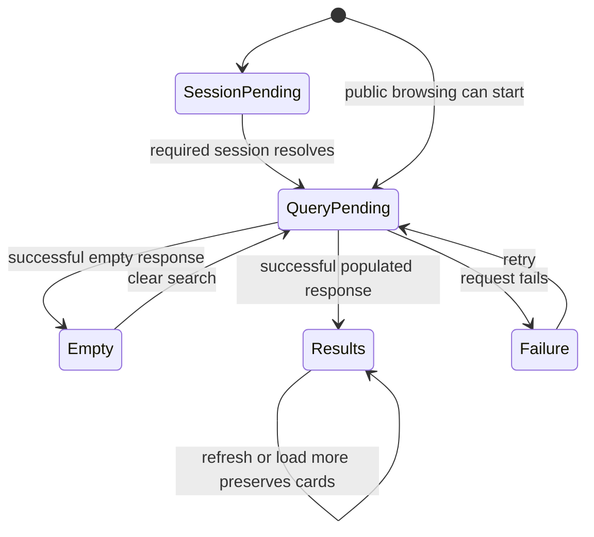
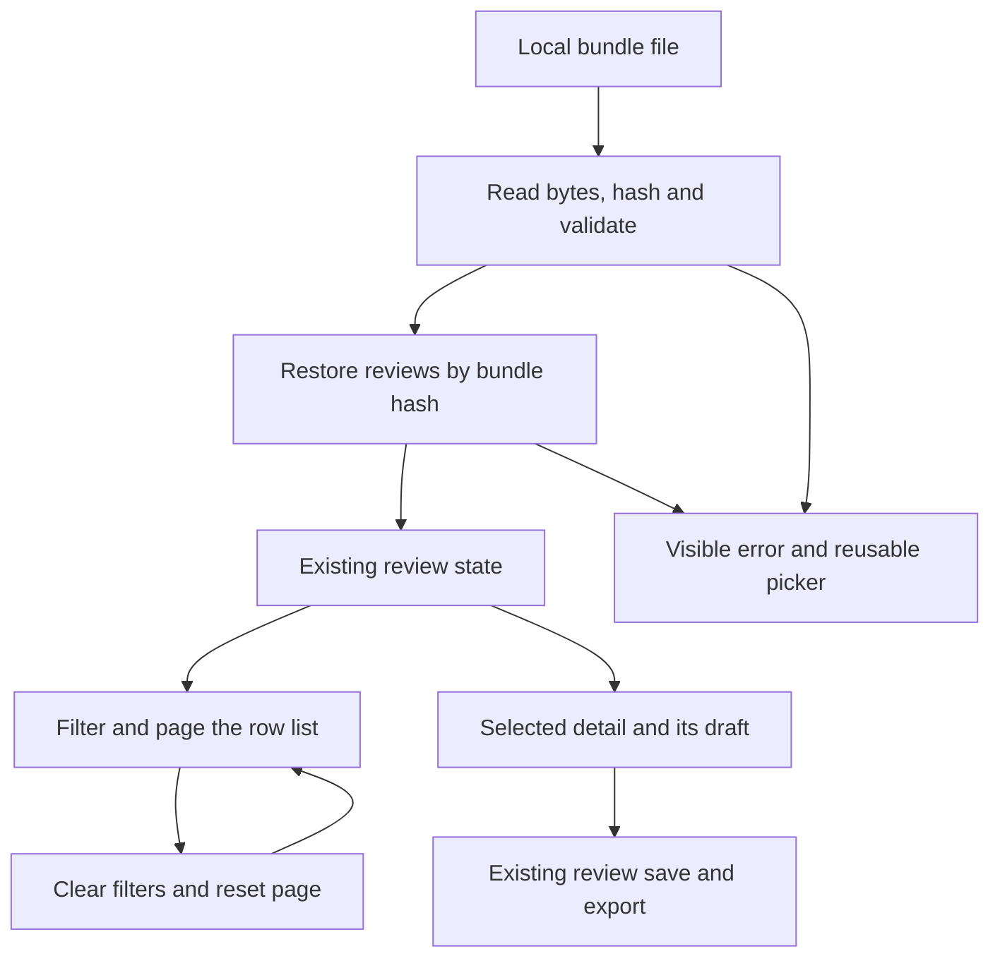

# First-visit demo polish for ow-5 - Plan

## Goal Capsule

- **Objective:** A first-time BAIF viewer can understand what OntoKit is doing, recover from an empty view, find editor shortcuts, and confidently begin reviewing a hydration bundle.
- **Means:** Improve the existing project list, editor help and hydration-review surface in place (KTD1–KTD4).
- **Authority:** The controller's ow-5 mandate and standing drawdown rules, then `AGENTS.md` and the relevant repository plans. The chief repository's authority is `docs/plans/2026-10-26-0705-feat-codex-drawdown-campaign-plan.md`, Goal Capsule and campaign R11, R15–R20 only. That file and `ops/drawdown/mandates/_common.md` are absent from this sandbox; the supplied mandate is the available campaign evidence. The controller must reconcile those exact sections before publication. No unseen wording is claimed as verified.
- **Execution boundary:** This stage produces and locally commits planning documents only. The later build stage runs `lfg` on this plan, implements, simplifies, reviews, tests and commits on `drawdown/ow-5`. R7–R8 govern delivery; no remote or credential discovery belongs to this lane.
- **Completion owner:** The builder supplies local implementation evidence. The controller scans, pushes and opens the PR against `dev`; the campaign merge gate handles merging and the expansion freeze. Hosted acceptance remains distinct from local UI evidence.
- **Stop conditions:** Stop dependent work if it requires a new service, migration, data rewrite, release, spend, security change or a forbidden credential read (R8). Complete independent work and report the exact constraint instead of bypassing it.

---

## Product Contract

### Summary

Make existing empty and loading states useful, make editor shortcut help easy to discover and use, and tidy the hydration viewer's entry and review states. Preserve its local review workflow and OntoKit's existing access boundaries.

### Problem Frame

The integrated BAIF rehearsal and hydration viewer already supply the main workflows. Several first-visit moments still provide little direction: project-search emptiness has no reset action, loading shells have no named status, and hydration input instructions lead with a producer script. The existing help shortcut also rejects a common physical question-mark keystroke.

The mandate names an older hydration feature branch, but its code is already in this checkout. Rebuilding or importing that branch would obscure the smaller remaining work.

### Requirements

The following R-IDs are local to this plan. References marked **campaign** refer to the supplied drawdown rules.

**First-visit orientation**

- R1. Empty states explain the current state and offer an applicable next action, while distinguishing no matches, no content and restricted access.
- R2. Loading states communicate that work is pending and preserve useful content during subsequent fetches; request failures remain errors with the existing recovery action.
- R3. Editor shortcut help is discoverable and usable by mouse and keyboard, and describes the shortcuts actually available in the current context.
- R4. Hydration review presents a clear local-file entry and readable review layout, with useful guidance when rows, samples, rates or exclusions are empty.

**Compatibility**

- R5. Existing project permissions, provider-aware sign-in, editor/proposal guards and shortcut focus/modifier boundaries keep their behavior.
- R6. Hydration polish preserves bundle identity, stored reviews, sampling, export reconciliation, text fidelity and the boundary that reviewing never writes to FOLIO.

**Evidence and delivery**

- R7. Add tests for changed behavior without deleting, weakening or skipping existing tests; commit real Playwright screenshots of changed pages under `docs/plans/evidence/` and identify their paths in the build handoff (campaign R15–R16).
- R8. Keep ow-5 on `drawdown/ow-5` as one expansion, with local-only commits in this clone and controller publication (campaign R15, R17, R19). Observe the 2026-11-03 through 2026-11-06 expansion merge freeze (campaign R18), public-safe writing, the no-credential-read hard stops (campaign R11), and blocker reporting (campaign R20).

### Key Decisions

- **Guarded expansion delivery.** Governs R7–R8. (session-settled: user-directed — chosen over holding every expansion for personal review: the campaign merges verified expansions behind its guardrails.)
- **Proceed without waiting on the user.** Governs R8. (session-settled: user-directed — chosen over waiting for availability: Damien has no time through 2026-10-30.)
- **Keep the assigned item boundary.** Governs R8. (session-settled: user-directed — chosen over speculative features after the backlog is exhausted: subsequent work becomes durable hygiene.)

### Scope Boundaries

The active scope is the existing home project list, the editor's loading/help affordances, and `/hydration-review`. It includes focused accessibility work on the controls changed here.

No CTT namespace or quotation changes, ALEA AWS provisioning, billing work, schema migrations, data rewrites, package releases or outside services are authorized. No sends, credential/security-setting changes, unbacked deletion or force-push are permitted.

#### Deferred to Follow-Up Work

- ow-1 and ow-2 own hosted rehearsal/persona acceptance and its login prerequisites.
- ow-3 owns notification socket hardening; ow-4 owns broader roadmap reconciliation.
- ow-6 owns broad rehearsal coverage, a full accessibility audit and dependency audit. This plan does not replace those obligations.
- B34's other feeders, server-backed hydration collaboration and application of approved rows remain outside this review-only slice.

#### Considered and Not Built

- A guided tour, bundled demonstration data and new global navigation were considered unnecessary: existing routes and actions can explain this bounded workflow. Reconsider only after observed navigation failures.
- A generic empty-state framework, global shortcut registry or tabs rewrite would enlarge the change without being needed for R1–R4. Keep component-local state and existing tab behavior.
- Background parsing workers and new persistent draft/review formats are not needed for presentation polish. A reproduced responsiveness or data-integrity defect should receive its own scoped diagnosis.

---

## Planning Contract

### Verified Starting State

Static inspection on 2026-10-26 began from clean branch `drawdown/ow-5`, HEAD `43783d39e37f43b222516f737c4cff6837e5c547`, with no Git remotes. No tests, build, server or browser were run during planning. Historical pass counts below are not current acceptance evidence.

| Surface | Evidence in this checkout | Planning consequence |
|---|---|---|
| Integrated prerequisites | `f3228d7b` contains rehearsal work; `06088bed` contains hydration review; `43783d39` contains the sweep handoff update | Do not fetch, cherry-pick or recreate the named feature branches; their remote refs are absent here |
| Project discovery | `app/projects/page.tsx` redirects to `/`; `app/page.tsx` owns infinite queries, debounce, loading skeletons, empty messages and retry | Modify the home route; preserve queries and current authorization checks |
| Loading edge | Required auth disables the initial project query while session state loads, but the rendered loading branch checks query `isLoading` only | Add a session-pending presentation case without changing when queries may run |
| Help | `app/projects/[id]/editor/page.tsx` supplies live definitions to `components/editor/KeyboardShortcutDialog.tsx` | Improve the existing trigger/dialog; do not build another help system |
| Question mark | The page registers `key: "?"`; `lib/hooks/useKeyboardShortcuts.ts` requires unshifted events when Shift is unspecified | Characterize and repair shifted `?` narrowly; other modifier matching stays strict |
| Hydration | `components/hydration-review/HydrationReviewView.tsx` already supports local import, filtering, sampling, rates, exclusions and export | Polish state presentation and recovery rather than replace its workflow |
| Tests | Existing home/editor integration suites, hook tests and hydration component/library tests cover important contracts | Extend these suites; do not replace their checks with snapshots |
| Browser harness | `playwright.config.ts` loads an isolated-stack run manifest, uses `testDir: "./e2e"`, and disables automatic captures | Add a separate UI smoke suite outside that directory; preserve its profile/evidence contract |

The repository's roadmap is `docs/plans/2026-09-20-0649-requirements-delivery-roadmap.md`. The current historical sources are `docs/handoffs/2026-10-20-sweep-cloud-ontokit-web.md` and `docs/plans/2026-10-20-hydration-review-viewer-plan.md`. B34 remains partially delivered; this item does not establish hosted acceptance or close its other feeders.

### Assumptions

These are bounded planning choices inferred from the mandate, not new user-approved product requirements.

- Improve the existing English copy and slate/primary light/dark styling; a new visual identity or localization rollout would exceed ow-5.
- Treat the home project list as the first-visit empty/loading surface, with a small editor loading label alongside its help changes.
- Use “Clear search” for project results and “Clear filters” for hydration rows. Preserve the current project visibility tab; hydration reset clears its row filters and returns pagination to the beginning.
- Retain an open hydration detail when its row leaves the filtered list and explain that state. This avoids discarding a typed correction merely to make an empty list look cleaner.
- Desktop evidence uses 1440 × 900; narrow evidence uses 390 × 844. Table-local horizontal scrolling is acceptable; clipped controls and page-wide overflow caused by this change are not.
- Synthetic local browser checks provide the required UI proof without DEV personas. The complete campaign source check is a controller publication prerequisite, not a request for Damien.

### Key Technical Decisions

- KTD1. **Extend current components.** Keep `app/page.tsx` query/cache ownership, the editor shortcut array, and hydration state in their existing owners. Reuse Button, Dialog and the current layout utilities; add no package dependency.
- KTD2. **Show real pending states.** Distinguish required-session waiting, initial data loading, background refresh and load-more. Pending file reads use an announced busy state and temporarily disable the bundle picker; they do not invent a progress percentage.
- KTD3. **Match the produced question mark.** The help binding accepts `event.key` equal to `?` with either Shift state, while still rejecting Ctrl/Meta/Alt. Limit this exception to the help binding and preserve explicit Shift requirements elsewhere. The help text comes from the existing active definitions and platform formatter.
- KTD4. **Keep hydration data ownership intact.** Add reset/empty-state presentation around existing filtering and pagination. Do not change `folio-review-bundle/1`, `folio-review-export/1`, IndexedDB version or keys, sample membership, material-rate denominators, review classifications or text rendering. Keep the selected RowDetail instance mounted through filter/reset interactions so its local draft and note survive.
- KTD5. **Separate public-safe UI evidence from full-stack acceptance.** A new `playwright.demo-polish.config.ts` targets `ui-tests/demo-polish.spec.ts`, outside `e2e/`. Use real pages and browser storage, synthetic fixtures and browser-boundary API responses. Existing optional/providerless mode supplies anonymous browsing/proposing for this local test process; do not change application authorization or hosted settings. `lib/env.ts` and `next.config.ts` already support this mode without provider credentials.
- KTD6. **Retain the campaign's model/review split.** Local work uses Astra; cloud build stages use the Codex Cloud default Sol and retain the controller's Astra/Fable reviews. (session-settled: user-directed — chosen over the Sol-first local ladder and a cloud model override: these execution choices were settled by the campaign.) This plan's document review does not claim those later review gates passed.

### State Transitions

The existing data paths remain in place. These sketches show the presentation boundaries for KTD2 and KTD4.

### Behavior Trace and Risks

`onBundleFile` reads bytes, hashes and parses them, then awaits the store before setting the loaded bundle. Failure returns to the input view and clears loading in `finally`. `createFallbackStore` already handles unavailable IndexedDB; the existing notice tells the user to export before closing. Preserve those paths and the exact-byte hash.

`filterRows` preserves the selected row through a review-status change, but does not pin it through branch/component/partition/search changes. `RowDetail` owns unsaved correction text and notes in local state. A reset must not replace its key or remount it. When selection falls outside the current list, show an explanatory cue and keep navigation absent until the selection is in range again.

Sampling deliberately ignores search and review-status filters. Its population is the complete branch/component/partition selection, not the visible page. Empty-population guidance must use that same population; a search with no matches must not disable a valid sample.

The editor's help is controlled without a DialogTrigger, so focus restoration needs explicit browser proof. Existing global save/add bindings intentionally work in some editable contexts; only help and other non-global bindings are suppressed there. The shortcut help must not promise that Ctrl/Cmd+S commits Turtle source.

No API change or paired API deployment is needed. Shared hook changes carry the main regression risk, so focused shortcut tests precede them. Runtime baseline results, browser availability and exact final spacing remain build-time questions; they are not claimed resolved by this plan.

---

## Implementation Units

### U1. Give project loading and empty states useful next steps

**Goal:** A visitor can distinguish waiting, failure and an empty result and recover using the current project-list actions.

**Requirements:** R1–R2, R5, R7. **Dependencies:** None.

**Files:** Modify `app/page.tsx`; extend `__tests__/app/home-page.test.tsx`. Preserve `app/projects/page.tsx` as the redirect.

**Approach:** Follow KTD1–KTD2 and the reset assumption. Add a visible loading message and appropriate status/busy semantics around existing skeletons. Give search a persistent accessible name. Add Clear search to the no-match state and Browse public projects to authenticated empty My Projects. Keep current headings, create/sign-in actions, retry and load-more behavior. Hide decorative motion from assistive technology and respect reduced motion on changed indicators.

**Execution note:** Characterize required-session pending and search-reset behavior before changing rendering.

**Test scenarios:**

1. Required-session loading shows a pending state and no false empty message; its project query remains disabled. Optional/providerless public browsing still starts normally.
2. A delayed successful query moves from named loading to cards or a true empty state; a failed query shows the existing retry action.
3. A no-match search cleared by keyboard resets the visible and debounced terms coherently, retains the visibility tab, returns to the first result page and focuses search. A pending debounce cannot reinstate the old term.
4. Authenticated empty My Projects can switch to Public; anonymous/private/providerless states retain their existing permitted actions and create/sign-in guards.
5. Background refetch, load-more pending and load-more failure preserve already loaded cards and their recovery controls.

**Verification:** Existing home tests and these additions pass; U4 captures loading and no-match recovery in the real page.

### U2. Make editor shortcut help visible and reliable

**Goal:** A viewer can find help, open it with a real question-mark keystroke, and return to the editor with useful focus.

**Requirements:** R2–R3, R5, R7. **Dependencies:** None.

**Files:** Modify `app/projects/[id]/editor/page.tsx`, `components/editor/KeyboardShortcutDialog.tsx` and `lib/hooks/useKeyboardShortcuts.ts`. Extend `__tests__/app/editor-page.integration.test.tsx`, `__tests__/components/editor/KeyboardShortcutDialog.test.tsx`, `__tests__/lib/hooks/useKeyboardShortcuts.test.ts` and `__tests__/lib/hooks/useKeyboardShortcuts.integration.test.tsx`.

**Approach:** Apply KTD3 to the existing help binding. Add a visible Shortcuts label where the header has room, retaining its accessible name and compact narrow-screen control. Explain help scope inside the existing dialog and retain the active definition list. Add named editor loading text to the existing pending render. Restore focus to the opener after Escape/close; do not broaden permission gates or shortcut availability.

**Patterns:** Existing Radix Dialog wrapper, `formatShortcut`, live shortcut definitions and suggestion-card `shouldFire` predicates.

**Test scenarios:**

1. The button and both shifted/unshifted `?` events open help once; `/`, Ctrl/Meta/Alt combinations and explicit Shift shortcuts retain their original matching behavior.
2. Input, textarea, select, contenteditable, Monaco and another open dialog suppress help without consuming the user's key. Existing global and Monaco-opt-in bindings still work as designed.
3. Escape and the close button close help and return focus to the originating control; role/capability-dependent entries match the registered definitions.
4. Suggestion Enter/Delete/e act only with a focused suggestion card; ordinary buttons/links retain keyboard activation.
5. Required-session, project-load and redirect waits show named pending states; existing private, no-ontology and unauthorized flows still pass.

**Verification:** Hook/dialog/editor regressions pass. U4 uses a physical Shift+Slash browser sequence and captures the open dialog.

### U3. Clarify hydration entry, empty views and review layout

**Goal:** A reviewer understands how to start and can recover from an empty view without losing review context.

**Requirements:** R1–R2, R4, R6–R7. **Dependencies:** None.

**Files:** Modify `components/hydration-review/HydrationReviewView.tsx`, `components/hydration-review/RowTable.tsx`, `components/hydration-review/ExclusionsPanel.tsx` and `app/hydration-review/page.tsx`. Extend `__tests__/components/hydration-review/HydrationReviewView.integration.test.tsx`; extend `__tests__/fixtures/hydrationBundle.ts` only for valid empty/long-text fixtures. Existing `RowDetail`, `RatesTable`, `ScriptText` and `lib/hydration-review/` are contracts to preserve, not rewrite targets.

**Approach:** Apply KTD4. Lead entry copy with the reviewer's file/action and local-storage explanation; keep producer-script details secondary. Make the file action visibly keyboard-focusable, disable it while pending, and retain error/retry behavior. Add a Clear filters action and distinct guidance for an empty bundle versus no matches. Explain empty Samples/Rates/Exclusions using actual counts. Disable drawing only when the real sampling population is zero. Use wrapping toolbars and contained table scrolling to keep controls readable with long values, RTL text and a narrow viewport.

**Patterns:** Existing notice/alert semantics, `EMPTY_FILTER`, `pageOf`, full-population `drawSample`, SHA-keyed store, `ScriptText` and current responsive detail layout. Keep the current tab implementation and state ownership.

**Test scenarios:**

1. Opening a file announces pending work and prevents a second file selection until it settles. Invalid data restores a usable picker; selecting a valid file afterwards succeeds.
2. A zero-row valid bundle gets a true empty state. Zero matching rows gets Clear filters; reset restores the full list/page without clearing reviews, samples or the selected detail's draft/note.
3. A selected row outside dimension/search filters remains visibly identified as outside the list. Reset restores its navigation; reviewing within the Unreviewed queue preserves the existing selection pinning.
4. No saved samples, no completed reviews and zero exclusions each give an accurate next step/context. A zero sampling population cannot create an empty sample, while a search-only no-match state still permits sampling its nonempty dimension population.
5. A saved correction survives reopening the same bundle. Export still reconciles against that bundle hash; incomplete drafts, older imports, exclusions and memory-store warnings retain existing behavior.
6. RTL, script markers, control-character badges and long IRIs retain text fidelity and accessible controls. Layout adjustments do not change row order, review statuses or denominators.

**Verification:** Existing hydration component/library tests plus the added cases pass. U4 verifies real IndexedDB reload, download and public-safe screenshots.

### U4. Prove the changed screens and record local evidence

**Goal:** Supply repeatable browser proof and reviewable screenshots for this expansion.

**Requirements:** R5–R8. **Dependencies:** U1–U3.

**Files:** Create `playwright.demo-polish.config.ts`, `ui-tests/demo-polish.spec.ts` and `ui-tests/fixtures/demo-polish.ts`; add the `test:ui:demo-polish` script in `package.json`. Reuse `__tests__/fixtures/hydrationBundle.ts`. Write `docs/plans/evidence/ow-5/README.md` and the screenshots listed below. Update the ow-5 entry in `docs/plans/2026-09-20-0649-requirements-delivery-roadmap.md`.

**Approach:** Follow KTD5. Use the real routes, QueryClient, help and hydration store. Fixture public project/list/tree reads at browser HTTP boundaries, using the allowlist pattern in `__tests__/app/editor-page.integration.test.tsx`; fail unexpected API requests and mutations. Exercise the editor's existing anonymous proposal route with a synthetic public ontology and a source path. Do not fabricate a privileged login or add a production test bypass.

Run against an owned local server with matching optional/providerless build and runtime configuration. Use `ontokit-web.sh` for background server management, after selecting an unused port; its non-interactive force behavior must not terminate a neighboring process. No environment files or credentials are read. If the sandbox prevents launching the browser/server, retain the suite and report the failed attempt; the controller must run it and supply screenshots before R7 is satisfied.

**Browser scenarios:**

1. Hold a project-list response to capture loading, then return no matches and use Clear search to recover to a synthetic public project.
2. Open editor help by its trigger and physical Shift+Slash, close it with Escape and verify focus return. Test that an editable field retains typed `?`.
3. Open a synthetic hydration file, make a correction, reload/reopen it and observe restored review state through real IndexedDB. Download and inspect the existing export schema/hash.
4. Filter to no rows, clear filters and confirm a typed detail draft survives. Check the selected-outside-filter cue and the empty sample guidance.
5. Inspect changed controls at desktop and narrow sizes, light and dark themes, keyboard focus and reduced motion. Verify that hydration tables scroll locally and touched controls are not clipped.

**Verification:** Tests assert behavior before taking screenshots. The evidence note records revision, commands, result counts, fixture scope, viewports/themes and screenshot paths. This is local UI evidence, not DEV, OIDC or full-stack rehearsal acceptance.

---

## Verification Contract

All commands below are for the build stage. Dependency installation uses the supplied cache; no dependency upgrade is part of this item.

| Gate | Command or proof | Acceptance |
|---|---|---|
| Starting baseline | `npm run test -- --run`, `npm run lint`, `npm run type-check` | Record actual pre-change results; distinguish baseline/environment failures from regressions |
| U1 | `npm run test -- --run __tests__/app/home-page.test.tsx` | Existing and added project-state cases pass |
| U2 | `npm run test -- --run __tests__/app/editor-page.integration.test.tsx __tests__/components/editor/KeyboardShortcutDialog.test.tsx __tests__/lib/hooks/useKeyboardShortcuts.test.ts __tests__/lib/hooks/useKeyboardShortcuts.integration.test.tsx` | Matching, focus, role and pending-state cases pass |
| U3 | `npm run test -- --run __tests__/components/hydration-review __tests__/lib/hydration-review` | Existing data contracts and added presentation/reset cases pass |
| U4 | `npm run test:ui:demo-polish` (new, targets the separate config) | Browser behaviors pass and actual PNGs exist |
| Final regression | `npm run test -- --run`, `npm run lint`, `npm run type-check`, `npm run build` | No introduced failures; existing tests remain intact |
| Diff and evidence | `git diff --check`; inspect each PNG and evidence note | Public-safe, truthful evidence; no production/test bypass or unrelated changes |

The evidence directory must contain these real captures; they are proposed paths, not artifacts produced during planning:

- `docs/plans/evidence/ow-5/projects-loading.png`
- `docs/plans/evidence/ow-5/projects-no-results.png`
- `docs/plans/evidence/ow-5/editor-shortcuts.png`
- `docs/plans/evidence/ow-5/hydration-entry.png`
- `docs/plans/evidence/ow-5/hydration-review-desktop.png`
- `docs/plans/evidence/ow-5/hydration-review-narrow-dark.png`

Use only repository synthetic data. Do not commit downloaded real bundles, session state, private fixture identities, raw environment output or machine-local paths. The build handoff lists each capture as `SCREENSHOT: <repo-relative path>`.

There is no `release:validate` script in this checkout and no release in scope. Keep the existing rehearsal suite and profile registry unchanged; their hosted execution belongs to the other assigned items.

---

## Definition of Done

- U1–U3 deliver R1–R6, with their existing and additive tests passing.
- U4 satisfies R7 with a runnable browser suite, inspected screenshots and an evidence note that states its local fixture limits.
- No implementation result is inferred from old test counts, historical plan checkboxes or this planning commit.
- The final diff contains only ow-5 implementation, tests and documentation; no abandoned experimental code or unrelated test changes remain. Preserve unrelated work and obey the backup requirement for any removal.
- The roadmap records the plan, actual completion evidence, remaining blockers and next controller action without closing unrelated B-IDs.
- The builder commits locally on the assigned branch. The controller checks the unavailable campaign sections, performs the required reviews and publishes under R8, respecting the expansion freeze.
- If any essential external prerequisite remains, the handoff names its owner, recovery action and exact acceptance claim still unproved. A Damien-only decision uses the mandate's `## Needs your decision` fields; no such decision is currently identified.
