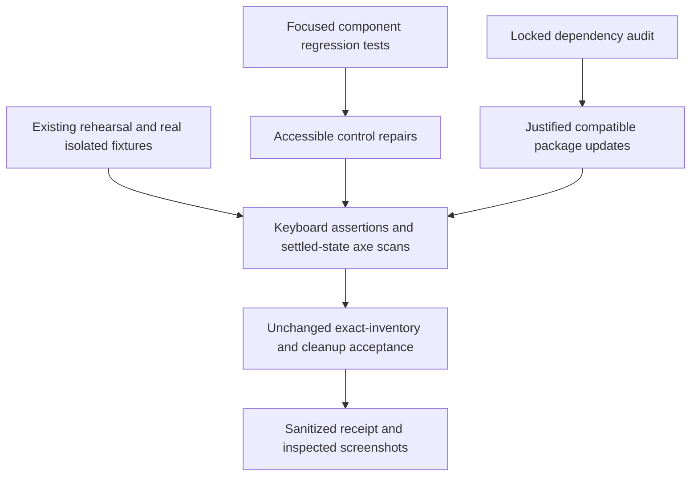

# BAIF rehearsal coverage and accessibility hygiene - Plan

## Goal Capsule

- **Objective:** BAIF presenters and contributors can reliably browse, propose and review FOLIO and Catholic OS edits, including with a keyboard, with current regression and dependency evidence.
- **Means:** Strengthen the existing rehearsal, repair demonstrated accessibility gaps, and audit the locked dependency graph (KTD1–KTD4).
- **Authority:** The controller's `ow-6` mandate and standing drawdown rules govern this item; `AGENTS.md` and `docs/plans/2026-09-20-0649-requirements-delivery-roadmap.md` govern repository delivery. The chief repo's `docs/plans/2026-10-26-0705-feat-codex-drawdown-campaign-plan.md` remains campaign authority. Its Goal Capsule and cited R11/R15–R20 were unavailable in this clone; only the controller-supplied summaries were available. The controller must reconcile those sections before the build stage, without reading the whole campaign plan or changing this item's scope.
- **Execution boundary:** This delivery stage commits planning documents only. The build stage implements, simplifies, reviews and commits through `lfg` on `drawdown/ow-6`. The controller handles scans, push and a PR targeting `dev`; the campaign gate handles merge. This clone gains no remote, login or credentials (Campaign R15/R17/R19).
- **Stop conditions:** Apply R6–R8. Missing execution prerequisites block their evidence claims, not independent implementation. No Damien decision is required to begin the bounded build.

---

## Product Contract

### Summary

Extend the four existing BAIF rehearsal cases with keyboard and automated accessibility checks. Repair the accessible names, focus handling, error announcement and review-tab behavior those paths expose, and produce a dated dependency audit with justified compatible repairs.

### Problem Frame

The BAIF rehearsal is already integrated, but historical passing receipts do not establish the current checkout's behavior. Its browser paths do not presently prove keyboard review or scan accessible states. Current source also exposes specific accessibility gaps along those paths. The dependency manifest has advanced beyond the framework versions described in `AGENTS.md`, so earlier audit conclusions cannot serve as a current baseline.

### Requirements

**Rehearsal and accessibility**

- R1. Preserve and strengthen all four existing real-browser rehearsal cases: sign-in/FOLIO browse, FOLIO propose/review/merge, Catholic OS browse, and Catholic propose/review/merge. Preserve their source/index persistence and CTT-retention assertions. Trace: `ow-6`, D11, B11 and the B13 coverage slice.
- R2. Make the rehearsed application controls operable and understandable by keyboard and assistive technology, with focused regression tests for each repair. Preserve existing save, permission, language and review behavior.
- R3. Add automated accessibility checks for the application states reached by the rehearsal and retain separate keyboard assertions; report the audit's actual scope and unresolved findings without claiming whole-product conformance.

**Dependency and acceptance evidence**

- R4. Audit both the complete locked dependency tree and its production subset, record advisory dispositions, and apply only demonstrated compatible dependency repairs. Unavailable audit data remains unknown.
- R5. Commit public-safe execution evidence under `docs/plans/evidence/`, including a genuine Playwright screenshot of every changed page/state, and identify each image in the build-stage final message with `SCREENSHOT: <path>`. Keep local verification distinct from hosted DEV acceptance. Trace: Campaign R16 and the mandate's frontend guardrail.

**Preservation and delivery**

- R6. Never delete or weaken existing tests or their acceptance gates; keep existing behavior passing and the API/web contract compatible. Scope is this hygiene item only. Trace: Campaign R15–R17.
- R7. Do not read credential files, `.env*`, `*.pem`, `*.key`, `twin-secrets/` or the prohibited secrets directory; do not spend, change credentials/security settings, send messages in the user's voice, force-push, or delete data without a verified backup. No schema migration, data rewrite, package release or new outside service is authorized by this item. Trace: Campaign R11/R15/R16.
- R8. Keep publication with the controller and preserve the 2026-11-03 through 2026-11-06 expansion freeze. If a true user-only dependency emerges, finish independent work and return its need, setting, estimated minutes and unblocked outcome under `Needs your decision`; draft any message without sending it. Trace: Campaign R18–R20.

### Key Decisions

- **Durable hygiene stays within the mandate.** Governs R1–R4 and R6. (session-settled: user-directed — chosen over speculative features: the campaign directs hygiene once assigned work reaches this item.)
- **Routine delivery uses the campaign gates.** Governs R5–R8. (session-settled: user-directed — chosen over holding ordinary guarded changes for personal review: the controller and merge gate own publication.)

### Scope Boundaries

The changed product surfaces are the shared editor search toolbar, class label fields, proposal dialog and suggestion review tabs. Changes elsewhere require a reproduced accessibility failure on the same rehearsal path and remain subject to R6–R7.

No ontology content, CTT namespace or quotation decision changes are included. ALEA AWS provisioning, paid services, auth-policy changes, major framework migrations and new test-only product routes are outside this item.

#### Deferred to Follow-Up Work

- Hosted DEV rehearsal/persona activation stays with `ow-1`/`ow-2`; no credentials are sought here.
- New demo polish and hydration-viewer features stay with `ow-5`.
- B13's recurring full-stack browser CI, Firefox matrix, failure-trace policy and broader API response-contract checks remain open. This plan delivers a rehearsal coverage slice and does not close B13.

**Considered and not built:** a replacement browser harness, generalized accessibility dashboard, new CI provisioning and blanket dependency upgrades. The existing profile already exercises the necessary product chain; no demonstrated gap warrants those mechanisms. A reproduced inability to validate this item through the existing harness would reopen that technical choice.

---

## Planning Contract

### Re-verified Starting State

Source inspection on 2026-10-27 found a clean `drawdown/ow-6` at `43783d39e37f43b222516f737c4cff6837e5c547`, with no remote. No tests, installation, build, browser run or vulnerability audit ran during planning.

| Surface | Verified state | Consequence |
|---|---|---|
| Rehearsal integration | History contains `f3228d7b` (rehearsal), `06088bed` (hydration review), and `43783d39` (rehearsal handoff update). The named `origin/*` refs are absent. | Use integrated files and historical receipts as context; do not recreate or fetch those branches. |
| Browser coverage | `e2e/browser/rehearsal.spec.ts` has four serial cases using three ordinary personas and real pinned ontology copies. | Extend existing cases; preserve state ordering and all assertions. |
| Discovery and acceptance | `scripts/e2e/auth-modes.mjs` assigns one spec/project to rehearsal; `scripts/e2e/evidence.mjs` requires its exact inventory and rejects skips, retries, duplicates and mixed profiles. | Do not create an accidentally baseline-owned sibling spec or loosen inventory validation. |
| Accessibility | Search and primary label inputs lack explicit programmatic names; explicit search dismissal does not restore focus; submit errors lack alert semantics; review tabs lack keyboard handling and control associations. | Target these four seams, then resolve further demonstrated failures within R2–R3. |
| Packages | Lockfile v3 matches manifest root declarations: Next 16.3.1, React 19.2.8, Playwright 1.63.0, Vitest/coverage 4.1.10. `axe-core` 4.11.2 is transitive; `@axe-core/playwright` is absent. | Add the adapter explicitly rather than relying on a transitive package; do not infer advisories from versions alone. |
| CI | `.github/workflows/release.yml` runs lint, types, Vitest, hermetic harness suites and builds; it runs no browser profile or explicit dependency audit. Setup uses Node 24. | Preserve current gates and document the remaining recurring-browser coverage gap. |
| Runtime | The launcher requires a local Unix Docker endpoint, a matching API checkout and Chromium. This sandbox denies Unix sockets and supplies no API checkout. | Full-stack proof needs an enabled controller runner; a unit pass is not a substitute. |

The 2026-10-20 handoff and `docs/releases/d11-rehearsal-run-b8f83d0879baa4677f72f4a57a0c6739.json` establish historical local acceptance only. They do not prove this plan or current DEV acceptance.

### Key Technical Decisions

- KTD1. **Extend the existing four cases.** Add assertions inside `e2e/browser/rehearsal.spec.ts` and a small shared accessibility helper. This reuses real identities, pinned imports and merge checks while retaining the existing exact inventory (R1/R3/R6). Additional independent cases are unnecessary for the current gaps.
- KTD2. **Repair semantics at the existing owners.** Search cancellation returns focus to its trigger; entity selection keeps its established navigation focus. Label inputs receive distinct names for language rows. The existing Radix dialog owns modal focus, and its submit error becomes an alert. Use the already installed Radix Tabs primitive directly with controlled, manual activation to preserve lazy Files loading (R2). No `components/ui/tabs.tsx` wrapper exists to reuse.
- KTD3. **Pair bounded axe scans with real key events.** Add a compatible explicit `@axe-core/playwright` development dependency, retaining Playwright 1.63.0. Scan settled application-owned content and portal dialogs using WCAG 2/2.1 A/AA tags. Do not scan the external provider or hide failing owned controls with blanket exclusions. Keyboard assertions remain necessary because automation covers only part of accessibility (R2/R3). Sources: [Playwright accessibility testing](https://playwright.dev/docs/accessibility-testing), [keyboard API](https://playwright.dev/docs/api/class-keyboard), [W3C modal pattern](https://www.w3.org/WAI/ARIA/apg/patterns/dialog-modal/).
- KTD4. **Inspect the lockfile before selecting upgrades.** Use separate complete-tree and production-only JSON audits against the existing npm registry. Record npm/report versions and distinguish findings from registry/tool failures. Inspect advisory dependency paths before targeted patch/minor updates; preserve justified overrides and avoid automatic `audit fix --force` (R4/R7). `fixAvailable` is a hint, not proof of compatibility. Sources: [npm audit](https://docs.npmjs.com/cli/v11/commands/npm-audit/), [audit reports](https://docs.npmjs.com/about-audit-reports/).
- KTD5. **Keep raw artifacts private; capture deliberately.** Preserve global trace/screenshot/video settings as off. Capture settled product states explicitly, exclude or mask account chrome without hiding the repaired controls, and visually inspect every committed PNG. Commit only a sanitized receipt, not raw axe node HTML, auth state or private runner reports (R5/R7). Use fixed viewport and disabled animations for repeatability. Source: [Playwright screenshot API](https://playwright.dev/docs/api/class-page#page-screenshot).
- KTD6. **Preserve campaign execution ownership.** Local work uses Astra rather than a Sol-first ladder; cloud build stages use their default Sol, and the controller retains the required Astra and Fable PR reviews. (session-settled: user-directed — chosen over a uniform model ladder: the campaign assigns models and reviews by execution setting.) This does not claim that any later review has already run.

### Assumptions

These are technical defaults inferred for this bounded item, not new product decisions:

- Chromium on the existing rehearsal profile is the browser target; Firefox remains the separately tracked B13 remainder.
- Manual tab activation means arrows/Home/End move focus and Enter/Space activates the focused tab. Runtime tests must confirm lazy diff loading and retained styling.
- Automated scan targets are the visible application content, navigation controls and open dialog on the exercised routes. A scan summary will name the exact checked states; incomplete or third-party results remain visible limitations.
- Compatible dependency remediation is selected from execution-time findings. A major-only fix or unpatched advisory receives a concrete residual record rather than an invented repair or clean bill of health.

### Technical Design and Sequencing

U1 establishes browser assertions; U2 makes demonstrated UI repairs. U3 can collect its baseline independently, then audits the final dependency tree after U1's adapter addition. U4 closes evidence only after the final source passes the applicable gates.

### System-Wide Impact and Execution Dependencies

The shared toolbar affects class, property and individual trees; preserve their callbacks and test their existing coverage. Label changes must retain draft/blur/save and multilingual source behavior. Review-tab changes must retain selected-proposal reset, lazy diff fetching, error/loading states and authorization checks. No API endpoint, schema, auth mode or ontology semantics change is planned.

The controller must provide the missing campaign excerpt and a permitted runner with the matching API source for real rehearsal verification. The runner must satisfy R7 before automatic fixture/stack cleanup: ownership checks alone are not a verified backup. Do not invoke a destructive cleanup path without the required backup assurance, or skip cleanup to manufacture acceptance. No cleanup redesign belongs in this item.

Browser/socket failure, unavailable registry data or a required dependency repair outside scope must be recorded with the failed prerequisite and controller return condition. Continue independent checks. Existing localhost-only Docker and evidence safeguards remain in force; no remote-Docker or authentication bypass is a fallback.

---

## Implementation Units

### U1. Strengthen the existing rehearsal's accessibility proof

**Goal:** Detect keyboard and accessible-state regressions in the genuine BAIF journeys.

**Requirements:** R1, R3, R5, R6. **Dependencies:** none for test authoring; successful execution follows U2 and U3.

**Files:** `e2e/browser/rehearsal.spec.ts`; new `e2e/fixtures/accessibility.ts`; `package.json`; `package-lock.json`.

**Approach:** Apply KTD1/KTD3/KTD5. Add role/name/focus assertions to the existing browse/propose/review flows and check the real Files diff before approval. Place scans after existing readiness assertions. Reuse imported projects and persona contexts; do not add fixture imports or change the four mandatory titles. Use the public-source receipt and explicit capture mechanism established in U4.

**Patterns to follow:** `e2e/fixtures/rehearsal.ts`, `e2e/fixtures/suggestions.ts`, `e2e/fixtures/polling.ts`, and `scripts/e2e/evidence.mjs`.

**Execution note:** Establish the failing accessibility assertions before repairing the controls; retain every existing assertion.

**Test scenarios:**

1. Open FOLIO search by keyboard, find the explicitly named input, cancel with Escape, verify trigger focus, reopen, then select the expected class and retain detail/URL checks.
2. Edit the target label through its accessible name, save and open the submit dialog; verify a settled dialog scan while preserving the real submit response and merge assertions.
3. In review, move focus across Summary/Files and activate Files with the keyboard; verify the actual proposed label in the loaded diff before the existing approval step.
4. Check settled editor/review application states for both ontologies, retaining Catholic OS uncalibrated-display and CTT-preservation assertions.
5. Any failed new assertion fails its existing case and therefore the unchanged exact four-case receipt gate; no skip or retry can make it accepted.

**Verification:** The final four-case rehearsal passes with the added assertions and no omitted existing coverage; existing profile/evidence negative tests still pass.

### U2. Repair the demonstrated accessibility gaps

**Goal:** Keep focus, names, errors and review navigation usable on the existing screens.

**Requirements:** R2, R3, R6. **Dependencies:** U1's scenarios define browser acceptance.

**Files:** `components/editor/shared/EntityTreeToolbar.tsx`; `components/editor/ClassDetailPanel.tsx`; `components/editor/SuggestionSubmitDialog.tsx`; `app/projects/[id]/suggestions/review/page.tsx`; `__tests__/components/editor/shared/EntityTreeToolbar.test.tsx`; `__tests__/components/editor/ClassDetailPanel.test.tsx`; `__tests__/components/editor/SuggestionSubmitDialog.test.tsx`; `__tests__/app/suggestion-review.integration.test.tsx`.

**Approach:** Apply KTD2. Preserve input placeholders used by existing helpers. Give each language row an unambiguous accessible name and stable label association. Keep Radix responsible for modal/tab mechanics, with existing styling and controlled review selection. Resolve additional scan failures only within the R2 scope boundary.

**Patterns to follow:** Existing toolbar controlled-state tests, ClassDetailPanel multilingual/data-integrity tests, the shared dialog primitive, and the review integration suite's real query/client boundary.

**Test scenarios:**

1. A stateful toolbar test proves keyboard open, initial focus, Escape/close focus return and reopening; selecting an entity does not have its navigation focus stolen.
2. Multiple primary-label language rows expose distinct names; editing one preserves the other language and the existing draft/save/cancel behavior.
3. An asynchronous submit failure is announced as an alert, retains the entered summary and dialog, and allows retry; cancellation returns focus and successful submission keeps existing close behavior.
4. Review tabs have one tab stop, correct tab/panel associations and manual keyboard activation. Moving focus alone does not fetch Files; activation does.
5. Files loading, failure and proposal-selection changes preserve existing request counts, stale-result protection and permission behavior.

**Verification:** Added component regressions and U1's browser assertions pass, alongside the existing shared-tree, class-detail, suggestion and review tests. Screenshots demonstrate the changed editor/dialog/review states in U4.

### U3. Audit and repair the locked dependency graph

**Goal:** Produce current, reviewable dependency findings and narrowly justified repairs.

**Requirements:** R4, R6, R7. **Dependencies:** collect a baseline first; final audit includes U1's adapter.

**Files:** `package.json` and `package-lock.json` only when a compatible repair is justified; new `docs/plans/evidence/2026-10-27-ow6-dependency-audit.md`.

**Approach:** Apply KTD4. Record baseline and final lockfile digests, runtime/tool versions, audit time, report modes, exit status, advisory IDs, dependency paths, usage surface, fix availability and disposition. Check the production subset as well as build/test dependencies. Do not introduce a custom audit wrapper, arbitrary suppression list or unrelated upgrade batch.

**Patterns to follow:** Existing manifest overrides, lockfile v3 and Node 24 from `.github/actions/setup-node/action.yml`.

**Test expectation:** No new behavioral tests for the report itself. A package repair must pass the affected existing regressions and the shared verification gates; add a focused regression when a demonstrated application defect requires one.

**Verification:** A complete dated audit supports every disposition. Compatible fixes remove their intended advisories without regressions. Registry errors and unresolved findings remain explicit, and a major-only or no-fix result is never represented as resolved.

### U4. Close the evidence and roadmap record

**Goal:** Make the completed hygiene slice independently reviewable without private artifacts.

**Requirements:** R5–R8. **Dependencies:** U1–U3.

**Files:** new `docs/plans/evidence/2026-10-27-ow6-rehearsal-hygiene.md`; PNGs under `docs/plans/evidence/ow6/`; `e2e/README.md`; `scripts/e2e/README.md`; `docs/plans/2026-09-20-0649-requirements-delivery-roadmap.md`; explicit capture calls/helper in the U1 files if needed.

**Approach:** Apply KTD5/KTD6. Capture the editor search/label state, open submit dialog and review Files state after readiness checks, using only disposable public ontology content. Export only inspected PNGs from private runner storage. Record final web/API revisions or source fingerprints, input pins, executed commands, case inventory, audit summary, scan scope, cleanup outcome and remaining limitations. Update B13 as a partial slice and leave hosted acceptance open.

**Test expectation:** Documentation needs no synthetic tests. Real Playwright captures and the existing accepted-run validator provide the evidence; inspect the images for visible controls, legibility and redaction.

**Verification:** Every changed page/state has an inspected PNG, each receipt matches the final tested source, and no unavailable step is marked passed. An execution blocker leaves the associated criterion open for the controller.

---

## Verification Contract

The build stage re-establishes the baseline before edits and records actual outcomes. These checks were not run during planning.

| Gate | Existing command or mechanism | Passing evidence |
|---|---|---|
| Lint and types | `npm run lint`; `npm run type-check` | No new errors or suppressed checks. |
| Component regression suite | `npm run test -- --run`; required coverage gate `npm run test:coverage -- --run` | Existing suite and new focused cases pass. Reuse one full coverage run as the full-suite result. |
| Harness safety and inventory | `npm run test:e2e:ownership`; `npm run test:e2e:profiles`; `npm run test:e2e:evidence`; `npm run test:e2e:identity`; `npm run test:ctt` | Existing inventories and negative checks remain enforced. Run under the supported non-root account. |
| Production build | `npm run build` using the existing credential-free optional-mode CI configuration | Build succeeds without reading local credential files. |
| Genuine rehearsal | Existing `test:e2e:rehearsal` entry point with its documented `--api-source` argument on an enabled runner | Two fresh final-source runs pass all four cases, with complete permitted cleanup and accepted local receipts, as required by the D11 plan. |
| Accessibility | KTD3 scans plus U1/U2 keyboard tests | No unresolved owned-UI violations in the selected scans; keyboard assertions pass. Record any third-party/incomplete findings separately. |
| Dependencies | Lockfile-only JSON audits with explicit inclusion of dev dependencies, and a separate production-only audit | Both reports are complete; R4 dispositions match final dependency versions. No failed request is treated as a clean report. |
| Visual evidence | Explicit Playwright captures under KTD5 | Inspected editor, dialog and review PNGs committed under `docs/plans/evidence/ow6/`. |

Source inspection, mocked component tests, screenshots and hosted acceptance prove different things. A blocked full-stack run is not replaced by a mocked browser pass. If a dependency repair touches auth/runtime behavior, rerun the relevant existing auth/suggestions profiles on the same permitted runner before accepting that repair.

---

## Definition of Done

- U1/U2 deliver the targeted accessibility behavior and additive coverage with every existing test and acceptance guard preserved.
- U3 provides complete before/after audit evidence and justified dependency dispositions; no unresolved finding is hidden behind a passing claim.
- U4 supplies inspected Playwright screenshots and final-source rehearsal receipts, with the roadmap recording the precise delivered slice and remaining B13/hosted work.
- R6–R8 hold, the final diff contains only this item, and abandoned experimental changes are removed through a backed-up/revertible edit process.
- The controller receives the local branch, plan, review outcome, verification evidence and any explicit unfulfilled criteria. Push, PR, reviews and merge remain separately reported campaign actions.

---

## Sources

- `docs/plans/2026-09-20-0649-requirements-delivery-roadmap.md` and `docs/audits/2026-09-20-requirements-backlog.md`: B11/B13 trace and distinctions between local, integrated and hosted acceptance.
- `docs/plans/2026-10-20-rehearsal-folio-catholic-ctt-plan.md` and `docs/handoffs/2026-10-20-sweep-cloud-ontokit-web.md`: existing journey and historical execution boundary. Current source owns exact executable paths where the older plan differs.
- `e2e/browser/rehearsal.spec.ts`, `e2e/fixtures/rehearsal.ts`, `scripts/e2e/auth-modes.mjs`, `scripts/e2e/evidence.mjs`, and `scripts/e2e/README.md`: fixture, inventory, execution and confidentiality contracts.
- Official documentation linked in KTD3–KTD5 supplies the accessibility, capture and dependency-audit guidance; it does not establish current repository test or vulnerability results.
