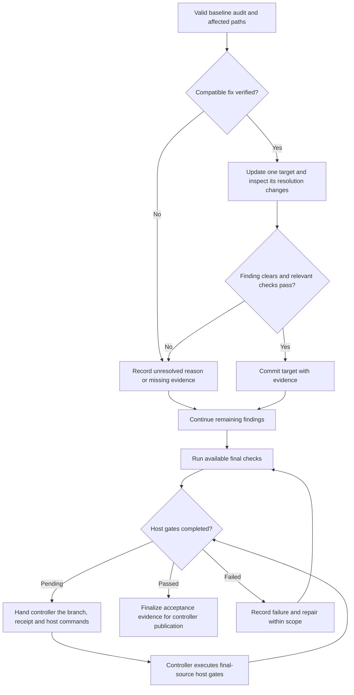

# Ow16 compatible dependency audit repairs - Plan

## Goal Capsule

- **Objective:** OntoKit users retain working FOLIO and Catholic OS workflows while maintainers can account for every outstanding dependency finding with a verified repair or a specific remaining limitation.
- **Means:** Audit-led, compatible package updates with separate commits and final-source regression evidence (KTD1–KTD5).
- **Authority:** The controller's ow-16 mandate, repository `AGENTS.md`, and `docs/plans/2026-09-20-0649-requirements-delivery-roadmap.md`. The chief repository's `docs/plans/2026-10-26-0705-feat-codex-drawdown-campaign-plan.md` and `ops/drawdown/mandates/_common.md` remain campaign authority. Their contents are absent here; the controller must reconcile the Goal Capsule and cited Campaign R11/R15/R16/R17/R18/R19/R20 before build dispatch. Campaign references below trace the supplied mandate, not an independently read chief excerpt.
- **Execution profile:** This stage commits the plan and its roadmap pointer only. The build stage runs `lfg` on this plan on `drawdown/ow-16`, implementing, simplifying, reviewing and committing locally. One controller-owned PR targets `dev`; the controller scans, pushes and opens it, and the campaign gate merges. No remote, GitHub login or credentials are sought in this lane.
- **Stop conditions:** An incompatible or unverified candidate remains unresolved while independent compatible repairs proceed. Missing browser, Docker, API or campaign prerequisites block the corresponding acceptance claim. R7 governs prohibited changes; only a genuine Damien-only blocker uses Campaign R20's decision format.

---

## Product Contract

### Summary

Work down the findings retained by the ow-6 dependency audit. Apply compatible patch and minor repairs, preserve existing application behavior and tests, and refresh the audit receipt with comparable before-and-after counts and a disposition for each finding.

### Problem Frame

The ow-6 audit left 26 affected package entries, including a critical Next.js entry, and 16 production-subset entries on 2026-10-28. The current lockfile is byte-identical to that receipt's final lockfile. Those counts describe the old advisory snapshot; they do not establish today's audit result, runtime exploitability or behavioral compatibility.

### Requirements

**Repair and accounting**

- R1. Re-establish the starting full-tree and production-subset audit results, then account for every historical and fresh finding by advisory and affected lockfile path. Remediation covers ow-6's affected packages and findings in the graph changed by their permitted repairs; unrelated fresh-only findings receive a follow-up disposition. Trace: ow-16 and the ow-6 audit receipt.
- R2. Apply only compatible patch/minor changes that clear a finding, with one deliberate package target per commit and its necessary dependency-resolution changes explained. No major upgrade, unrelated refresh or forced peer resolution is authorized. Trace: ow-16.
- R3. Give each remaining in-scope finding a supported reason: no compatible fix, a major/breaking upgrade needed, or demonstrated development-only exposure with no application runtime path. Record major candidates without applying them. Missing metadata remains unverified, never a clean result. Trace: ow-16.

**Compatibility and evidence**

- R4. Preserve every existing test, assertion, coverage gate and rehearsal contract; add focused regression coverage for dependency behavior that existing tests do not exercise. No removal, skip, relaxed assertion or timeout increase may hide a failure. Trace: ow-16 and Campaign R15/R16.
- R5. Pass `npm test`, coverage, lint, types, production build, the repository's remaining regression gates, and executed Playwright rehearsal and demo-polish suites against final source. Discovery-only, mocked, skipped or historical results cannot satisfy a browser gate. Trace: ow-16.
- R6. Refresh the ow-6 audit receipt with dated before-and-after counts and link fresh public-safe evidence under `docs/plans/evidence/ow-16/`. Preserve historical evidence, capture affected frontend pages with Playwright, and name each new screenshot in the build-stage final response as `SCREENSHOT: <path>`. Trace: ow-16 and Campaign R16.

**Scope and delivery**

- R7. Work only ow-16 on `drawdown/ow-16`; leave CTT namespace/quotation choices, ALEA AWS provisioning and anything that bills untouched. No credential/security-setting changes, forbidden-file reads, credential discovery, sends in Damien's voice, unbacked deletion, force-push, migrations, data rewrites, package releases or new outside services are authorized. Trace: ow-16 and Campaign R11/R15–R20.
- R8. Keep local checks, controller acceptance and publication distinct in the audit receipt and roadmap. Report unavailable gates honestly and retain the controller's required Astra/Fable reviews and campaign merge gate. Trace: Campaign R15/R19/R20.

### Key Decisions

- **Continue durable hygiene within the mandate.** (session-settled: user-directed — chosen over speculative features when planned work and expansions run out: the campaign directs maintenance.) Governs R1, R2, R7.
- **Preserve guarded campaign delivery.** (session-settled: user-directed — chosen over holding expansions for personal review: the campaign's guardrails and reviews govern delivery.) Governs R7, R8; this item is hygiene and adds no expansion.

### Scope Boundaries

The default implementation diff is dependency manifests, focused compatibility tests, new evidence and the roadmap. A small application adaptation belongs only when a permitted update demonstrates an actual regression; characterize it first and keep its tests additive.

Do not remove or disable Codecov, Scalar, sanitization, audit reporting or existing overrides to lower a count. A new audit service, generic upgrade automation and a new test harness were considered and are unnecessary: the existing npm reports, test runners and evidence validators cover this task. Reconsider only if execution demonstrates a gap they cannot represent.

#### Deferred to Follow-Up Work

- Major or otherwise breaking package migrations and any coordinated direct-peer upgrade that cannot meet R2 remain documented candidates.
- Unrelated fresh-only audit findings remain visible with their advisory evidence, current exposure and follow-up owner; they do not authorize additional package work. A newly introduced vulnerability in an ow-16 update cannot use this deferral.
- Changing the production Monaco CDN version or asset delivery is outside this lockfile repair. Any discrepancy between the repaired npm node and the shipped sanitizer stays explicit under KTD4.
- Broader B11/B13 work, hosted persona acceptance, earlier lanes' pending browser acceptance and deployment remain separately owned. Ow-16 evidence must not silently close those obligations.

### Acceptance Examples

- AE1. Covers R1–R3. Updating root Zod clears its affected path, but Codecov still resolves affected Zod 3: the root repair is recorded and the nested finding stays open with its own reason.
- AE2. Covers R1, R2. A target advisory disappears while a newly published advisory raises the total count: the receipt identifies both changes rather than calling the repair a failure solely from the total or claiming a clean tree.
- AE3. Covers R5, R8. All local checks pass but Chromium cannot launch in the lane: browser acceptance stays pending, with executable host commands and required source identity supplied to the controller.

---

## Planning Contract

### Re-verified Starting State

Static inspection on 2026-11-21 found a clean `drawdown/ow-16` at `3d36271d`, which includes the ow-15 review repair, ow-12 integration and ow-11 scan repair. There is no remote, local `dev` ref or named rehearsal remote ref. The current base cannot be compared with live `dev` in this lane. No audit, install, test, build or browser run was performed during planning.

| Evidence | Current fact | Consequence |
|---|---|---|
| `package-lock.json` | Lockfile v3; SHA-256 `995f91ee6b71f9df76e2dafe2133f021f2c66b4f8da44d911079cc1fdc7d2842` matches ow-6's final hash | Use the historical inventory as the starting checklist, then obtain fresh audit results. |
| `package.json` and lockfile | Next 16.3.1, Scalar React 0.9.63, DOMPurify 3.3.3, root Zod 4.4.3, Codecov core/plugin 2.0.1 | Runtime and nested findings remain distinct repair targets. |
| Existing overrides | `dompurify ^3.3.2`, `minimatch@3 ^3.1.3`, `minimatch@9 ^9.0.7`, `ajv@8 ^8.18.0` | Preserve protections and major-specific resolution boundaries. |
| Toolchain | Vitest/coverage 4.1.12, Vite 8.0.16, Playwright 1.63.0; CI selects Node 24 | Vitest's historical findings were already repaired; freshness alone is not a reason to update it. |
| JSDOM 30.0.1 engines | `^22.22.2 || ^24.15.0 || >=26.0.0` | Use a Node 24 patch at least 24.15.0, also satisfying every selected candidate's engines. Do not reuse the old Node 22.22.1 result. |
| `Dockerfile` | Install, build and runtime stages derive from `node:22-alpine` | Check candidates against the actual resolved Node 22 image patch as well as Node 24 CI. Existing JSDOM requires Node 22 at least 22.22.2 during installation/testing. |
| `next.config.ts` | Imports Codecov and constructs its plugin in the webpack configuration; upload is conditional | Development classification does not erase build-time exposure. Never obtain or enable an upload token for this work. |
| Scalar/Monaco tests | Mock their library boundaries | Existing unit passes cannot prove those upgraded browser bundles work. |
| `components/editor/TurtleEditor.tsx` and `e2e/ui/ow4-fixtures.ts` | Production requests CDN Monaco 0.45.0; the UI fixture substitutes installed Monaco 0.56.0 assets at that URL | Record which bytes each run exercises. Updating the npm DOMPurify node does not establish that either prebuilt editor bundle contains the repair. |
| Screenshot specs | Default explicit paths point to ow-5 and ow-12 | Override both evidence-directory variables before capture; Playwright `outputDir` alone is insufficient. |

Historical full-tree counts are critical **1**, high **15**, moderate **2**, low **8**, total **26**; production-subset counts are **1/7/1/7**, total **16**. These are affected package entries, including propagated findings, not independent vulnerability counts.

### Key Technical Decisions

- KTD1. **Compare advisory identities as well as counts.** Use full and production lockfile audits with the same recorded Node/npm and registry configuration. Preserve timestamp, source revision, lock hash, command, exit, severity totals and validity of each report. A vulnerability exit is different from a network error or malformed response. Re-audit saved baseline and final manifests close together if advisory drift affects attribution. [npm audit](https://docs.npmjs.com/cli/v11/commands/npm-audit/) explains omission and propagated vulnerabilities. Implements R1/R3.
- KTD2. **Repair one target through its existing owner or compatible leaf.** Prefer a named package update within supported ranges; use narrowly scoped overrides only when parent compatibility is established. Record required transitive changes and reject unrelated resolution churn. Do not collapse Zod 3/4, Undici 6/8 or brace-expansion 1/5 onto a single major. A zero-major minor bump is potentially breaking, even when its first number stays zero. Do not introduce a major change through a transitive workaround. [npm update](https://docs.npmjs.com/cli/v11/commands/npm-update/) and [override semantics](https://docs.npmjs.com/cli/v11/configuring-npm/package-json/) support this approach. Implements R2.
- KTD3. **Choose versions from the complete fresh advisory set.** Primary-source candidates below are research leads, not accepted versions. Confirm published metadata, release changes, engines, peers, parent ranges and the actual resolved graph before selecting each target. Check engines against both the actual Node 24 CI patch and the Node 22 Alpine release-image patch; npm warnings do not establish compatibility. An npm `fixAvailable` value alone proves neither compatibility nor repair. Implements R1–R3.
- KTD4. **Separate library behavior from delivered-asset identity.** Preserve the current env/auth, editor, source-status, shortcut and hydration tests. Add real Scalar browser smoke when its closure changes and an explicit visible IRI-hover assertion for the sanitizer update. Record Monaco's requested URL, actual served version/artifact identity and any fixture substitution for each relevant run. Credit a DOMPurify update as an npm-node repair; credit the shipped sanitizer only when served-bundle evidence ties it to the fixed implementation. Otherwise retain that runtime attribution as unverified. Genuine rehearsal proves behavior of its observed assets; synthetic installed-asset checks do not prove production CDN bytes. Implements R4–R6/R8.
- KTD5. **Keep evidence bound to final source.** A clean install must reproduce the delivered lockfile. Use an empty owned validation checkout, or a verified backup before `npm ci` removes an existing `node_modules`. Run browser/Docker gates on a permitted host, keep all existing inventories, and record source/lock/API identity and cleanup outcomes using the existing harness. [npm ci](https://docs.npmjs.com/cli/v11/commands/npm-ci/) documents lock fidelity and deletion behavior. Implements R5–R8.
- KTD6. **Keep the campaign's model allocation.** Local work uses Astra, cloud builds use default Sol, and the controller retains Astra/Fable PR reviews. (session-settled: user-directed — chosen over a uniform Sol-first ladder: the campaign assigns models by execution setting.) Implements R8; no later review is claimed by this plan.

### Candidate Priorities and Coverage

The following groups account for all 26 historical package entries. A group is an ownership map, not permission to combine independent updates into one commit. Final per-advisory and per-node dispositions belong in U1's ledger.

| Priority / owner | Historical affected entries | Repair direction and boundary |
|---|---|---|
| Runtime framework | `next`, `nanoid`, `sharp`, `source-map-js`, `baseline-browser-mapping` | Start with a compatible Next 16.x target, then repair remaining affected leaves separately. Next's nested PostCSS/nanoid is distinct from root PostCSS. [Next advisories](https://github.com/vercel/next.js/security/advisories/GHSA-2464-fhr4-w9xw) identify 16.4.1 as a floor for cited findings; the [image advisory](https://github.com/vercel/next.js/security/advisories/GHSA-p3m5-59mp-jv5r) also requires Sharp at least 0.35.5. [16.4.6](https://github.com/vercel/next.js/releases/tag/v16.4.6) is a candidate, subject to fresh audit. |
| Editor sanitization | `dompurify` | Update the existing override floor and lock within major 3. [Maintainer advisory](https://github.com/cure53/DOMPurify/security/advisories/GHSA-c6gr-qvv4-5v3f) fixes through 3.4.16 in 3.4.17; [3.4.18](https://github.com/cure53/DOMPurify/releases/tag/3.4.18) adds hardening. Check all current advisories, preserve sanitization settings. |
| Environment validation | `zod` | Root major 4 has a [4.6.6 repair candidate](https://github.com/colinhacks/zod/releases/tag/v4.6.6). Track Codecov's nested major 3 separately; a global Zod4 override violates its parent range. |
| API documentation | `@scalar/api-reference-react`, `@scalar/api-reference`, `@scalar/agent-chat`, `ai`, `@ai-sdk/gateway`, `@ai-sdk/provider-utils`, `@ai-sdk/vue`, `vue`, `@vue/server-renderer` | Prefer a published compatible 0.9.x wrapper patch that repairs its owned closure, then compatible leaf repairs if needed. Preserve Vue family coherence. The [Vue advisory](https://github.com/vuejs/core/security/advisories/GHSA-g2v6-rqmx-r4w6) says no patched version while the historical receipt uses `<3.5.42`; reconcile that discrepancy before declaring closure. |
| Build coverage | `@codecov/webpack-plugin`, `@codecov/bundler-plugin-core` | Recheck compatible parent/Zod3 releases. [Core's manifest](https://raw.githubusercontent.com/codecov/codecov-javascript-bundler-plugins/main/packages/bundler-plugin-core/package.json) still requires `zod ^3.22.4`; retain explicit residuals if no compatible repair exists. |
| Lint/build parsing | `@babel/core`, `@humanfs/node`, `brace-expansion`, `browserslist`, `fast-uri`, `js-yaml` | Target each affected package within its current supported major, retaining nested brace-expansion 1 and 5. Use lint/build and affected transform tests for compatibility. |
| Test/build HTTP and transforms | `undici`, `vite` | Repair Undici 6 and 8 independently within their existing lines. Vite 8 is accepted by current Vitest and React plugin ranges; a leaf repair may avoid changing the pinned Vitest pair. |

`eslint-config-next` has no `next` peer requirement; version-number alignment alone does not justify another bump. Vitest and coverage have exact matching peers. If a new finding requires both direct packages to move and neither can be updated compatibly alone, record the unsupported single-target route and the coordinated candidate; do not use forced installation or disguise a second direct target as lockfile churn.

### Repair Decision Flow

### Assumptions and Execution Prerequisites

- Package-only repairs should preserve API contracts; matching API source is still required to prove the genuine rehearsal. No backend change is planned.
- Published candidate availability, audit counts and the precise compatible repair set are build-time checks. Unavailable metadata cannot support a no-fix claim.
- The controller supplies the chief excerpts and verifies the actual current `dev` base before build dispatch. The missing named rehearsal refs are reconciled through the integrated history and sweep handoff, without adding a remote here.
- This lane denies Unix sockets. Chromium, Docker and host-dependent checks remain controller work; do not launch or retry a browser here. Browser syntax/type checks are useful but do not satisfy R5.
- No Damien-only decision is identified. If one arises, finish independent work and record what is needed, setting, estimated minutes and what it unblocks under `Needs your decision`; draft any message without sending it.

---

## Implementation Units

### U1. Establish a current audit ledger

**Goal:** Identify the actual remaining findings and permissible repair candidates.

**Requirements:** R1–R3, R7, R8. **Dependencies:** reconciled campaign/base inputs.

**Files:** read `package.json`, `package-lock.json` and `docs/plans/evidence/2026-10-27-ow6-dependency-audit.md`; create `docs/plans/evidence/ow-16/dependency-audit.md`.

**Approach:** Apply KTD1/KTD3 before updates. Record every affected node/version, advisory, owning dependency, production membership, candidate and compatibility constraints. Compare the historical inventory with fresh findings, including withdrawn or changed advisories; identify unrelated fresh-only findings under R1's follow-up boundary. Preserve valid baseline evidence and manifest hashes for final comparison. Inventory current tests and source identity without assuming old passes still hold.

**Test expectation:** No new behavioral test for this documentation unit. Validate report structure, command exits and completeness of the ledger; an error report is not a zero count.

**Verification:** Every historical entry has a current disposition or an explicit unresolved evidence gap, and candidate selection can proceed without guessing package compatibility.

### U2. Repair runtime framework findings

**Goal:** Clear compatible framework and runtime-transitive findings without breaking application flows.

**Requirements:** R1–R5, R7. **Dependencies:** U1.

**Files:** `package.json`, `package-lock.json`, U1's ledger; existing tests in `__tests__/components/auth/user-menu.test.tsx`, `__tests__/app/auth-pages.integration.test.tsx`, `__tests__/config/auth-session.integration.test.ts` and `__tests__/config/docker-release-fidelity.test.ts`.

**Approach:** Apply KTD2/KTD3 first to Next, then each remaining affected leaf separately. Keep internal Next packages coherent through the published owner dependency graph. Verify Sharp and nested nanoid paths rather than inferring their repair from the Next version. Attribute each target's actual advisory delta in its own commit.

**Execution note:** Prefer install/build and existing integration checks first for package-only changes. Add a regression at the affected seam before any application compatibility adaptation.

**Test scenarios:**

1. Existing optional and required auth image flows retain provider startup, sign-in, session handling and user-image behavior after the framework update.
2. Genuine FOLIO/Catholic browse, source editing, submission, review and merge retain their existing results and permissions.
3. Image/runtime findings clear at every affected resolved path; a repaired root with a vulnerable nested copy remains a partial repair.

**Verification:** Targeted advisories clear, engine/peer constraints hold, local checks pass and final host integration remains explicitly gated by U5. Mocked auth/component tests do not replace Docker or browser acceptance.

### U3. Repair sanitizer and root validation findings

**Goal:** Update the compatible editor sanitizer and environment-validation packages while preserving their contracts.

**Requirements:** R1–R5, R7. **Dependencies:** U1; follow U2 for a stable final framework baseline.

**Files:** `package.json`, `package-lock.json`, ledger; `__tests__/lib/env.test.ts`, `__tests__/lib/auth-mode.test.ts`, `__tests__/config/next-config-env.test.ts`, `__tests__/config/auth-bootstrap.test.ts`, `__tests__/components/editor/TurtleEditor.test.tsx`, `__tests__/components/editor/TurtleEditor.coverage.test.tsx`; additive hover assertions in `e2e/ui/entity-source-preview-evidence.spec.ts` and `e2e/browser/rehearsal.spec.ts`.

**Approach:** Apply KTD2–KTD4 with separate DOMPurify and root Zod targets. Preserve current sanitizer configuration and environment validation behavior. Characterize a demonstrated integration regression before adapting application code; avoid importing private package internals just to manufacture a version test.

**Test scenarios:**

1. Existing valid environment/auth-mode configurations parse as before, and invalid combinations retain rejection behavior.
2. Independently of Scalar changes, the synthetic full-source evidence case opens a tooltip on a known prefixed fixture term, asserts its expanded IRI in the visible tooltip, and captures that state. Extend the genuine rehearsal's FOLIO browse case to open full source and check a known term's expanded-IRI tooltip, preserving the existing assertions and four-case inventory. Record the actual Monaco assets each run exercises under KTD4; existing read-only and save/review assertions remain.
3. Covers AE1. Root Zod removal from the affected paths does not mark Codecov's nested Zod3 or its propagated parent entries fixed.

**Verification:** Each npm target has a demonstrated repair and passing focused tests. U5 supplies actual browser behavior and asset identity; unsupported attribution of the shipped sanitizer remains an evidence gap even when npm audit clears. Nested Zod retains a separate disposition.

### U4. Repair documentation and development-tool findings

**Goal:** Clear remaining compatible findings and retain a specific reason for each residual.

**Requirements:** R1–R5, R7. **Dependencies:** U1–U3's resulting graph.

**Files:** `package.json`, `package-lock.json`, ledger; existing `__tests__/app/api-docs.integration.test.tsx`; new `e2e/ui/dependency-compatibility.spec.ts` when the Scalar closure changes, included additively in `playwright.ui.config.ts`.

**Approach:** Work through the remaining ownership-table targets using KTD2/KTD3, one deliberate package per commit. Prefer Scalar's published wrapper closure and verify Vue/AI SDK node outcomes. Preserve Codecov integration while checking for compatible fixes. Add the Scalar smoke to the existing synthetic UI harness, using local schema data and fresh evidence paths; do not enable an AI service or make backend writes.

**Test scenarios:**

1. The actual Scalar bundle mounts `/api-docs`, consumes a synthetic local OpenAPI document, shows its operation, and remains usable after light/dark theme changes without a client exception. Unit mocks prove configuration wiring only; this browser case covers the bundle.
2. Existing lint, transform, coverage and production build behavior passes after each relevant tool update; both installed Undici lines and every affected brace-expansion path receive a disposition.
3. Covers AE2. A new advisory or withdrawal is separated from the target's dependency change; unresolved nodes cannot disappear from the ledger merely because totals fall.
4. Codecov's build-time dependency remains visible in residual reasoning even if absent from the production audit; no major override or plugin removal masks it.

**Verification:** Every remaining in-scope finding is fixed or supported by R3's reasons; unrelated fresh-only findings have R1's follow-up disposition. Vue advisory conflicts and missing registry information remain explicit evidence gaps until reconciled. A development-only disposition explains both runtime absence and remaining build/test exposure.

### U5. Complete final verification and fresh browser evidence

**Goal:** Prove the delivered manifest/lock pair preserves the user's workflows.

**Requirements:** R4–R8. **Dependencies:** final source from U2–U4, permitted Chromium/Docker host and matching API checkout.

**Files:** new captures and public-safe run summary under `docs/plans/evidence/ow-16/<run-id>/`; retain `ui-tests/demo-polish.spec.ts`, `e2e/ui/keyboard-shortcuts.spec.ts`, `e2e/ui/entity-source-preview*.spec.ts`, `e2e/browser/rehearsal.spec.ts` and `__tests__/app/project-settings-github.integration.test.tsx`.

**Approach:** Apply KTD4/KTD5 and execute the Verification Contract against final source. Set `DEMO_POLISH_EVIDENCE_DIR` and `OW4_UI_EVIDENCE_DIR` to distinct new run directories before browser execution. Preserve the current four-case rehearsal and its keyboard/axe assertions, all demo-polish cases, source-status settings coverage and anonymous/authorized shortcut coverage. Inspect captures before committing them.

**Test scenarios:**

1. Project loading/search recovery, anonymous phone/desktop shortcut help, hydration persistence/filter/recovery and narrow dark/RTL review remain usable.
2. Authorized keyboard help, editor/project source preview, copy fidelity and read-only full-source behavior retain their complete existing assertions. U3's expanded-IRI tooltip is visible in its fresh screenshot, with the asset identity and substitution status recorded alongside the run.
3. The genuine rehearsal completes provider sign-in, FOLIO browse/propose/review/merge, and Catholic OS browse/propose/review/merge with unchanged CTT settings and pins.
4. Covers AE3. Missing prerequisites or any skipped, flaky or failed mandatory case leaves that gate pending/failed; a list-only or empty run is not accepted.

**Verification:** The controller has actual passing final-source runs with complete inventories, source/lock/API fingerprints and fresh inspected captures. Preserve the inherited ow-6 requirement for two genuine final-source rehearsal runs and its backup/owned-cleanup safeguards. Close every owned browser, context, page and server.

### U6. Publish the audit accounting and roadmap receipt locally

**Goal:** Make repaired and remaining findings reviewable without overstating acceptance.

**Requirements:** R1–R3, R6–R8. **Dependencies:** U1–U5 results, including truthful pending gates.

**Files:** U1's ledger; dated continuation in `docs/plans/evidence/2026-10-27-ow6-dependency-audit.md`; `docs/plans/2026-09-20-0649-requirements-delivery-roadmap.md`.

**Approach:** Finalize before/after full and production counts, per-advisory/node dispositions, target commits, fixed versions, remaining reasons and reproducible command outcomes. Preserve the original ow-6 record and link the new continuation. Apply KTD6 and hand the controller one local branch for current-`dev` reconciliation, scans, reviews and publication.

**Test expectation:** No synthetic documentation tests. Check links, hashes, inventory reconciliation, absence of forbidden/private content, and agreement between the receipt and actual results.

**Verification:** Every finding and acceptance gate has a supported outcome; no historical B11/B13 or hosted status is upgraded without its own evidence.

---

## Verification Contract

These are build-stage commands and required outcomes, not plan-stage results. Record the Node/npm pairs for Node 24 CI and the resolved Node 22 Alpine build/runtime image, verifying candidate engines against both. Do not read `.env*`, credential files, `*.pem`, `*.key` or `twin-secrets/`. Use credential-free CI settings and public synthetic fixtures.

| Gate | Existing command / mechanism | Required result |
|---|---|---|
| Full audit | `npm audit --package-lock-only --json --include=dev` | Valid baseline and final reports; severity and package-entry counts plus advisory/node disposition. |
| Production subset | `npm audit --package-lock-only --json --omit=dev` | Same comparison; omission is not proof of exploitability or runtime absence. |
| Lock reproducibility | `npm ci` in KTD5's safe validation checkout | No manifest/lock rewrite, compatible engines/peers and no forced resolution. |
| Vitest and coverage | `npm test -- --run`; `npm run test:coverage -- --run` | Full existing inventory passes with unchanged coverage requirements, including “In sync” settings regressions. |
| Lint and types | `npm run lint`; `npm run type-check` | No errors or new suppressions. |
| Harness regression | `npm run test:e2e:ownership`; `npm run test:e2e:profiles`; `npm run test:e2e:evidence`; `npm run test:e2e:identity`; `npm run test:e2e:hosted-unit`; `npm run test:ctt` | All six commands pass; Vitest alone does not run them. |
| Production build | `npm run build` with `.github/workflows/release.yml`'s optional auth and loopback API/WS configuration | Success without provider/Codecov credentials or external upload. |
| Demo polish, Chromium host | `npm run test:ui:demo-polish` | Complete `ui-tests/` suite executes and passes against an owned final-source server. |
| Source/shortcut UI, Chromium host | `npx --no-install playwright test --config playwright.ui.config.ts` | Complete configured `e2e/ui/` suite, including added compatibility cases, executes and passes. |
| Genuine rehearsal, host | `npm run test:e2e:rehearsal -- --api-source <matching-api-checkout>` | Two accepted final-source four-case runs with pinned inputs and required owned cleanup; synthetic UI results are separate. |
| Framework/auth integration, host | `npm run test:e2e -- --api-source <matching-api-checkout>` and the `test:e2e:auth-lifecycle`, `test:e2e:optional-configured`, `test:e2e:optional-anonymous`, `test:e2e:disabled`, `test:e2e:suggestions` scripts with the same API-source argument | Preserve the existing profiles when Next/auth-relevant dependencies change. Each required inventory passes. |
| Container and policy gates | Existing `.github/workflows/release.yml` Docker builds and `scripts/verify-auth-image.sh` matrix; `.github/workflows/semgrep.yml` | Controller records the resolved Node 22 image identity/patch, verifies compatible installation/build/runtime, and completes CI/security checks without altering policy. |

For both local UI suites, the permitted host can use `node e2e/ui/server.mjs 3105` on a free owned port, with `DEMO_POLISH_BASE_URL=http://localhost:3105` and `OW4_UI_BASE_URL=http://localhost:3105`. The wrapper invokes the required `ontokit-web.sh` manager with ownership checks; do not force-kill a competing listener. Set fresh repo-relative `DEMO_POLISH_EVIDENCE_DIR` and `OW4_UI_EVIDENCE_DIR` paths under `docs/plans/evidence/ow-16/<run-id>/`. Capture `/api-docs` there if Scalar changes. The genuine rehearsal uses the existing source-preparation and receipt protocol in `e2e/README.md`; it is not a hosted DEV acceptance claim.

If the lane cannot execute a gate, record its exact host command and pending status. Syntax checks may cover changed browser files locally; no browser launch or retry belongs in this socket-denied lane.

---

## Definition of Done

- U1–U4 satisfy R1–R4: every historical finding has a verified repair, supported residual reason or evidenced upstream withdrawal/changed applicability. Fresh findings in the repaired graph meet the same repair/residual standard; unrelated fresh-only findings have a recorded follow-up disposition. Advisory-data changes are never credited as package repairs, and every update has its own target commit.
- U5 satisfies R5/R6 on the delivered source, including actual passing rehearsal and demo-polish execution and fresh screenshots where required. Pending controller runs keep implementation acceptance open.
- U6 preserves historical evidence and roadmap distinctions, records counts and remaining exposure accurately, and contains only public-safe repo-relative references.
- R7/R8 hold. No abandoned experimental change, unrelated dependency refresh, weakened test or unverified clean-security claim remains in the diff. Cleanup respects verified backups.
- The controller receives `drawdown/ow-16`, this plan, the audit receipt, screenshot paths and review results for one PR targeting `dev`; local commits do not imply publication or deployment.

---

## Sources

- [Ow-6 dependency audit](evidence/2026-10-27-ow6-dependency-audit.md) and [implementation receipt](evidence/2026-10-27-ow6-rehearsal-hygiene.md).
- [Ow-6 plan](2026-10-27-0933-test-ow6-rehearsal-hygiene-plan.md), especially U3 and its verification contract.
- [Delivery roadmap](2026-09-20-0649-requirements-delivery-roadmap.md), [sweep handoff](../handoffs/2026-10-20-sweep-cloud-ontokit-web.md), and [ow-15 receipt](evidence/ow-15/README.md).
- Repository entry points: `package.json`, `package-lock.json`, `next.config.ts`, `lib/env.ts`, `app/api-docs/page.tsx`, `vitest.config.ts`, `playwright.ui.config.ts`, `playwright.demo-polish.config.ts`, `.github/actions/setup-node/action.yml`, `.github/workflows/release.yml`, and `e2e/README.md`.
- [Scalar wrapper changelog](https://raw.githubusercontent.com/scalar/scalar/main/packages/api-reference-react/CHANGELOG.md) and [Zod 3-to-4 breaking changes](https://zod.dev/v4/changelog) supplement the primary references attached to KTDs and candidate decisions above.
